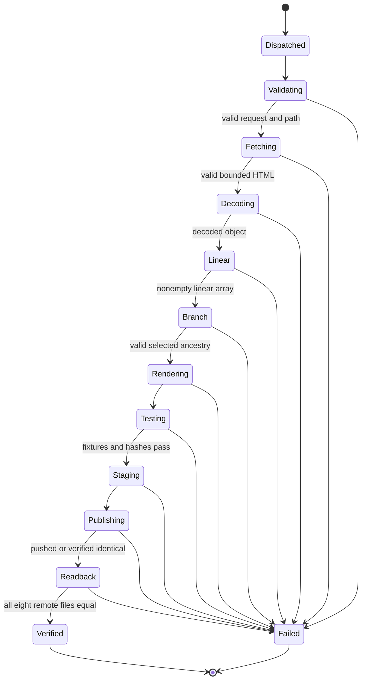

# Final Software Requirements Specification — Shared Conversation Extractor

**Identifier:** EXT-SRS-001  
**Version:** 1.0, 2026-11-03  
**Repository:** BestNameYet/Terminals  
**Design root:** workspaces/extractor-srs-design/  
**Status:** Final design baseline for implementation; NOT an assertion of implemented or tested runtime.  
**Source of truth:** ST​UDY.md (without the zero-width space), sources/issue-4-comments.json, and the current referenced source files. Where the five comments conflict, the decisions below are explicit design choices rather than claims of consensus.

## 1. Purpose and scope

Build a GitHub Actions workflow_dispatch-based Node.js pipeline to extract a public ChatGPT shared conversation from a validated HTTPS URL, preserve the original HTML and complete decoded linear data, independently reconstruct the selected visible branch, render machine-readable and human-readable transcripts, and commit all required outputs to a validated, run-scoped, templated path. The pipeline SHALL provide verifiable source hashes, regression evidence, Git publication receipts, and remote readback attestation.

The **complete profile** is mandatory. It preserves source linear order and original metadata; the **selected-visible projection** separately preserves mapping/current_node ancestry. Neither representation SHALL masquerade as the other.

### 1.1 Explicit exclusions

Private/authenticated shares, unsupported HTML serialization, arbitrary website crawling, source-page JavaScript evaluation, browser automation as the authoritative parser, OCR, fabrication of non-text media, inferred missing message content, claims to exhaust all alternate branches, and automatic Git rollback are out of scope. A future partial/export-only-visible profile requires separate approval and must not silently replace the complete profile.

### 1.2 Stakeholders and dependencies

Authorized repository owner/operator; workflow dispatcher; GitHub Actions runner; public ChatGPT share endpoint; GitHub repository and artifact service; downstream consumers of JSON/Markdown; maintainers of source provenance. Dependencies: network availability, Node.js 20, Ubuntu GitHub runner, Actions dispatch permission, contents write permission, access-controlled repository, supported share serialization.

## 2. Input interface

The canonical request is a JSON object supplied through the workflow_dispatch `request_json` string input. The workflow retains `target_url` and `write_path` as legacy dispatch inputs for backward compatibility. Exactly one input mode SHALL be used. When `request_json` is supplied, legacy inputs SHALL be absent/empty; otherwise `target_url` is required and `write_path` optional. YAML input defaults SHALL NOT inject nonempty legacy fields when JSON mode is used.

```json
{
  "target_url": "https://chatgpt.com/share/6ae8ca4c-fde8-83e8-991c-f6beaed35051",
  "write_path": "workspaces/shared-conversations/{share_uuid}/{run_id}-{run_attempt}",
  "request_id": "optional-correlation-id",
  "export_profile": "complete"
}
```

The URL is an illustrative syntactically valid value, not a test assertion that the share is available. Canonical request keys are exactly target_url, write_path, request_id, export_profile; the last three are optional and receive defaults. Unknown keys fail validation. No arbitrary command text, executable code or token is accepted in this JSON.

The resolved destination SHALL be a repository-relative directory within `workspaces/shared-conversations/`, unless the operator explicitly authorizes another project workspace destination. The intended design root `workspaces/extractor-srs-design/` contains only this documentation and is not a default transcript output path. Supported placeholders: share_uuid, run_id, run_attempt. Reject unknown placeholders, absolute paths, traversal, backslashes, empty path components, reserved `.git`/`.github` segments, symbolic-link traversal, collision with another run/source, and any destination outside the authorized workspace. No default URL shall be hardcoded in production.

## 3. Functional requirements

| ID | Mandatory requirement | Verification |
| --- | --- | --- |
| EXT-FR-001 | The existing manual-dispatch.yml SHALL expose workflow_dispatch and the canonical JSON request mode, preserving legacy target_url/write_path compatibility. | AT-01, AT-02 |
| EXT-FR-002 | The workflow SHALL validate JSON types, required keys, mutually exclusive modes, exact allowed keys and export_profile=complete before any network request. | AT-02–05 |
| EXT-FR-003 | The workflow SHALL validate https://chatgpt.com/share/<UUID> URLs; reject credentials, ports, invalid host/scheme/path and unsafe query/fragment handling. | AT-05 |
| EXT-FR-004 | The workflow SHALL derive share_uuid from the validated URL and resolve run_id/run_attempt only from trusted GitHub Actions context. | AT-06 |
| EXT-FR-005 | The workflow SHALL validate the resolved write path and all existing ancestor and leaf symlinks before writing. | AT-07 |
| EXT-FR-006 | The job SHALL check out the intended source revision, establish Node.js 20, and record workflow commit SHA and run identity. | AT-01 |
| EXT-FR-007 | The extractor SHALL fetch the original HTML exactly once per successful request, subject to bounded redirects, timeout, status, MIME and byte-size validation. | AT-08 |
| EXT-FR-008 | Every redirect SHALL be revalidated against the allowed public share origin and URL pattern; no credentials or session cookies SHALL be supplied. | AT-09 |
| EXT-FR-009 | The extractor SHALL persist exact original response bytes as response.html before parsing. | AT-10 |
| EXT-FR-010 | The decoder SHALL parse recognized React Router streamController.enqueue literal JSON strings into an indexed serialized table without executing downloaded scripts. | AT-11–13 |
| EXT-FR-011 | The decoder SHALL resolve indexed references with memoization, bounded traversal and cycle detection; unsupported serialization markers SHALL cause explicit errors rather than fabricated values. | AT-12–14 |
| EXT-FR-012 | The decoder SHALL locate and validate a conversation object and nonempty linear_conversation array, preserving all array entries in original source order. | AT-15 |
| EXT-FR-013 | The decoder SHALL preserve original node IDs, indices, parents, author role/channel, message metadata, content type, timestamps, recipients, content parts, model fields and other source-provided fields without invented values. | AT-16 |
| EXT-FR-014 | The decoder SHALL preserve the complete decoded conversation object in conversation-raw.json and a source-indexed linear projection in linear-conversation.json. | AT-16 |
| EXT-FR-015 | The selected-visible projection SHALL independently resolve mapping/current_node and reconstruct the current node's parent chain, detecting cycles and missing parents. | AT-17 |
| EXT-FR-016 | The selected-visible projection SHALL retain only nonempty user text and assistant commentary/final text, preserving source part order and ancestry chronology. | AT-18 |
| EXT-FR-017 | The exporter SHALL NOT use linear_conversation to infer the selected parent chain or substitute mapping traversal for a missing linear_conversation. | AT-19 |
| EXT-FR-018 | The exporter SHALL produce conversation.json and conversation.md from the identical selected-visible record sequence, with role/channel/count parity. | AT-20 |
| EXT-FR-019 | The exporter SHALL produce diagnostics.json with per-representation counts, message identifiers, exclusions, mismatches and parsing method/version; it SHALL NOT suppress observed divergence. | AT-21 |
| EXT-FR-020 | The exporter SHALL produce receipt.json with source, run, method, counts, byte lengths and SHA-256 for all six primary data outputs plus diagnostics; receipt SHALL NOT self-hash. | AT-22 |
| EXT-FR-021 | The workflow SHALL run positive/negative fixture tests and verify JSON schema, linear order, ancestry order, selected role counts, Markdown parity and all recorded hashes before staging. | AT-23 |
| EXT-FR-022 | The workflow SHALL copy only eight allowlisted files to the validated destination: response.html, conversation-raw.json, linear-conversation.json, conversation.json, conversation.md, diagnostics.json, receipt.json, execution.json. | AT-24 |
| EXT-FR-023 | The workflow SHALL update any applicable *documented* Terminals metadata registry, if present, without inventing or importing another repository's inventory format. | AT-25 |
| EXT-FR-024 | The workflow SHALL upload the complete capture set as a GitHub Actions artifact with a declared retention policy and mark incomplete failed-run artifacts as diagnostic only. | AT-26 |
| EXT-FR-025 | The workflow SHALL stage only the allowlisted destination and any required documented inventory, commit if changed, and push with bounded conflict retries and no destructive force push. | AT-27 |
| EXT-FR-026 | Publication to main SHALL be serialized for conflicting Git updates; a second run SHALL NOT overwrite another run's destination. | AT-28 |
| EXT-FR-027 | After push the workflow SHALL fetch remote main and compare all eight required committed output files byte-for-byte against the local verified files. | AT-29 |
| EXT-FR-028 | The workflow SHALL emit an external final Actions attestation and summary containing run ID, run attempt, commit SHA, destination, remote verification, source hash and final status. | AT-30 |
| EXT-FR-029 | A run SHALL be called VERIFIED only after every mandatory gate and remote readback succeeds; an accepted dispatch, local artifact, or Git push alone SHALL NOT constitute verified completion. | AT-30 |
| EXT-FR-030 | All failures SHALL produce an explicit phase, error code and status, without leaking tokens or claiming successful publication. | AT-31 |
| EXT-FR-031 | The operator interface SHALL support querying the specific run and its final attestation; Issue #3 terminal dispatch SHALL be optional and used only after its permissions and run-correlation path are verified. | AT-32 |
| EXT-FR-032 | Fixed-fixture reruns SHALL produce identical conversation data and deterministic renderings, apart from explicitly identified run-specific provenance. | AT-33 |

## 4. Output data contracts

### 4.1 Complete decoded data

`conversation-raw.json`:
```json
{
  "schema": "extractor.conversation.raw.v1",
  "source_url": "<validated URL>",
  "share_uuid": "<UUID>",
  "decoder_version": "<version>",
  "conversation": {}
}
```
`conversation` SHALL be the decoded source object, not a selectively summarized reconstruction. A source value may be absent, null, structured or non-text. No synthetic values may be inserted inside `conversation`.

`linear-conversation.json`:
```json
{
  "schema": "extractor.conversation.linear.v1",
  "source_url": "<validated URL>",
  "count": 1,
  "nodes": [
    {"source_index": 0, "node": {}}
  ]
}
```
The example count is illustrative. Every original linear array element SHALL have one corresponding entry, including null/atypical entries where present; `node` contains the original decoded entry.

### 4.2 Selected visible projection

`conversation.json`:
```json
{
  "schema": "chatgpt.shared-conversation.visible.v1",
  "source_url": "<validated URL>",
  "counts": {"user": 1, "commentary": 0, "final": 1},
  "messages": [
    {"role": "user", "channel": null, "text": "example"},
    {"role": "assistant", "channel": "final", "text": "example"}
  ]
}
```
The illustrative messages are not purported source data. The renderer SHALL use the existing selected-branch Markdown conventions: `# Conversation`, `**You**`, `**Assistant · Commentary**`, `**Assistant**`, and `---` turn separators. Content shall be escaped/quoted so user-supplied text cannot fabricate structural transcript boundaries.

### 4.3 Diagnostics and receipts

`diagnostics.json` SHALL include schema version, source identifiers, parser strategy/version, indexed-table size, linear node count, mapping node count, ancestry count, visible message counts, ordered source IDs, omitted-role/channel counts, malformed/unsupported entries, comparison mismatches and warnings.

`receipt.json` SHALL include schema version, request_id, share_uuid, source URL, source HTTP status, run ID/attempt, source code SHA, parser version, extraction method identifiers, input validation result, counts, per-file SHA-256 and byte lengths, and preliminary publication state. The receipt SHALL NOT contain its own hash, a future commit SHA, or a false remote-success claim.

`execution.json` SHALL include a versioned state log and evidence available **before** the publication commit, including phases, source hashes, tests, local validation and intended destination. It SHALL NOT contain the commit SHA of the commit that contains execution.json. The post-push verification SHA and outcome SHALL be recorded outside that commit in the Actions attestation.

## 5. Nonfunctional requirements

| ID | Attribute | Requirement |
| --- | --- | --- |
| EXT-NFR-001 | Runtime | Ubuntu runner, Node.js 20; 15-minute Actions job timeout |
| EXT-NFR-002 | HTTP timeout | 45 seconds per request; bounded to five fetch iterations |
| EXT-NFR-003 | HTML bound | Maximum accepted downloaded HTML: 25 MiB |
| EXT-NFR-004 | Security | No eval, Function, vm execution, downloaded-code import, credentials or cookie use in HTML decoding |
| EXT-NFR-005 | URL isolation | HTTPS and exact approved share origin on every redirect |
| EXT-NFR-006 | Filesystem | Repository-relative allowlisted output path, no traversal/symlink write-through |
| EXT-NFR-007 | Integrity | SHA-256 and exact-byte readback for every committed output |
| EXT-NFR-008 | Fidelity | Source linear index order and selected parent ancestry order remain distinct and verifiable |
| EXT-NFR-009 | Determinism | Same fixture and parser revision yield identical data/Markdown output |
| EXT-NFR-010 | Concurrency | Non-cancelling publication concurrency; bounded three-attempt push/rebase conflict policy |
| EXT-NFR-011 | Observability | Correlated request/run IDs, phase errors, artifact and final Actions attestation |
| EXT-NFR-012 | Retention | Artifact retention declared (proposed 90 days); committed raw files persist subject to repository policy |
| EXT-NFR-013 | Privacy | Raw source and metadata may be sensitive; repository access policy SHALL be approved before deployment |
| EXT-NFR-014 | Compatibility | Parser version, schema version and golden fixtures SHALL be tracked; unsupported source shapes fail closed |
| EXT-NFR-015 | Error handling | Mandatory failure cannot yield VERIFIED; diagnostic partial outputs explicitly marked |
| EXT-NFR-016 | Least privilege | Contents write and Actions dispatch permission SHALL be granted only to authorized callers; no issue-comment command injection |
| EXT-NFR-017 | Scope integrity | Complete profile SHALL never silently degrade to visible-only extraction |
| EXT-NFR-018 | Performance | One successful source fetch, one shared indexed decoding pass, then O(L+M+P) projection work; no unsupported throughput SLA asserted |

## 6. Execution state machine and invariants



**Invariants:** (I1) one request maps to one immutable run identity; (I2) every linear node is preserved with its source index; (I3) selected chronology follows parent edges; (I4) the two chronologies are never silently conflated; (I5) visible JSON count equals the sum of allowed role/channel counts; (I6) Markdown and JSON visible-message counts match; (I7) every required file's SHA-256 equals its receipt hash; (I8) no output escapes the authorized destination; (I9) no self-referential commit/hash is claimed; (I10) VERIFIED implies remote byte equality for all eight files; (I11) no untrusted source script is evaluated; (I12) unsupported source structure is not fabricated.

## 7. Failure semantics

| Phase | Failure examples | Required response |
| --- | --- | --- |
| Dispatch | Missing permission, no run ID | Fail dispatch or report UNCONFIRMED, never VERIFIED |
| Validate | Bad JSON, mixed modes, invalid URL/path | Fail before network |
| Fetch | HTTP error, unsafe redirect, timeout, oversize, non-HTML | Fail with bounded error and diagnostic evidence |
| Decode | No recognized literal stream, malformed table, unsupported tag | Fail; retain source artifact where safe |
| Linear | Missing or empty linear_conversation | Fail complete profile, no ancestry fallback |
| Branch | Missing current_node, cycle, missing parent | Fail selected projection, no linear substitute |
| Render | Unsupported content, inconsistent counts | Fail, no publication |
| Test | Fixture mismatch, hash mismatch, non-deterministic render | Fail before staging |
| Publish | Conflict, unauthorized push, partial commit | Fail or retry bounded; do not claim rollback |
| Readback | Missing remote file, different bytes/hash | Fail verification |
| Attest | Missing run/commit correlation | UNVERIFIED, not VERIFIED |

## 8. Acceptance and validation plan

| Test | Procedure | Pass criterion |
| --- | --- | --- |
| AT-01 | Dispatch valid JSON request | Unique run ID and accepted job |
| AT-02 | Legacy target_url/write_path | Accepted without JSON mode |
| AT-03 | Mixed JSON and legacy modes | Rejected |
| AT-04 | Missing/extra/wrong-typed JSON fields | Rejected before fetch |
| AT-05 | Non-HTTPS, wrong host, credentials, malformed UUID | Rejected |
| AT-06 | Expand default template using trusted run context | Expected isolated path |
| AT-07 | Absolute/traversal/symlink/unauthorized workspace path | Rejected |
| AT-08 | Valid public share HTTP 200 HTML | One captured response, correct bytes |
| AT-09 | Unsafe redirect, empty/non-HTML/oversize response | Rejected |
| AT-10 | Compare response.html with downloaded byte stream | Exact equality |
| AT-11 | Known indexed stream fixture | Decoded without script execution |
| AT-12 | Malformed enqueue string/table | Controlled parse error |
| AT-13 | HTML with executable malicious script | Script never executed |
| AT-14 | Cyclic/unsupported indexed references | Controlled failure |
| AT-15 | Missing/empty linear_conversation | Complete profile fails |
| AT-16 | Mixed roles, metadata, nontext, null nodes | All original linear entries retained in source order |
| AT-17 | Mapping/current_node with branch and siblings | Correct parent ancestry, no sibling inclusion |
| AT-18 | User/commentary/final/tool/internal nodes | Only allowed selected-visible text retained |
| AT-19 | Linear/ancestry mismatch or missing one structure | Difference recorded; no silent fallback |
| AT-20 | Render selected-visible JSON and Markdown | Byte-stable output, role/count parity |
| AT-21 | Compare ordered linear IDs and selected ancestry IDs | Differences accurately diagnosed |
| AT-22 | Recompute every receipt hash and byte length | All match |
| AT-23 | Run positive and negative golden fixtures | All fixtures pass |
| AT-24 | Inspect staged file allowlist | Exactly eight required output files, plus documented inventory if applicable |
| AT-25 | Repository with/without documented inventory | Update only if applicable; no invented registry |
| AT-26 | Successful and failed-run artifact inspection | Complete or clearly diagnostic artifact |
| AT-27 | Simulated Git push conflict | Bounded retry, no force push |
| AT-28 | Two simultaneous run IDs | No overwrite; serialized publication |
| AT-29 | Fetch remote main after commit | Eight file bytes equal local originals |
| AT-30 | Inspect final run attestation | Run ID, SHA, path, hashes, VERIFIED only after readback |
| AT-31 | Inject each phase failure | Nonzero job, correct error/status, no false success |
| AT-32 | Invoke through Issue #3 terminal (if enabled) | Permission and correlated run receipt verified |
| AT-33 | Repeat fixture extraction twice | Deterministic output except documented run provenance |

**Release gate:** ALL AT-01 through AT-33 SHALL pass on the implemented workflow, except AT-32 may be marked NOT APPLICABLE if the optional Issue #3 dispatch integration is deliberately excluded from deployment. At least one live accessible share SHALL be extracted end-to-end and all eight published outputs read back successfully. No such acceptance suite has been run in this documentation-only task.

## 9. Implementation decomposition

1. Update .github/workflows/manual-dispatch.yml with canonical JSON mode, compatibility handling, concurrency, permissions, tests, publication and attestation.
2. Implement a Node.js extractor under the authorized Terminals workspace, with modules for input validation, HTTP capture, literal stream parsing, indexed resolver, linear export, ancestry export, rendering, diagnostics, receipts and CLI.
3. Add versioned JSON schemas for request, raw, linear, visible, diagnostics, receipt and execution outputs.
4. Add fixtures and tests for positive and negative cases, including the 186-message IssueStack regression as a *reference* when its fixture is authorized and copied with provenance.
5. Integrate Git staging, bounded push/rebase, exact remote readback and Actions summary.
6. Test optional Issue #3 terminal-to-dispatch permissions and correlate run ID only if required.
7. Execute AT-01–AT-33 and publish evidence; obtain owner approval for raw-content retention/access before production.

## 10. Traceability and unresolved decisions

All five Issue #4 comment bodies are retained in sources/issue-4-comments.json. This SRS deliberately integrates comment 6602365561's dispatch and selected-branch contract with comment 6602452432's full linear extraction, while preserving the StateMachines readback gates from 6601504904/6601890052 and the IssueStack fixture/metadata practices from 6601564263.

**Owner decisions still required before deployment:** repository privacy/access policy for raw content; whether raw HTML may be committed permanently; artifact retention period (90 days proposed); whether destinations outside workspaces/shared-conversations may be explicitly authorized; whether Issue #3 terminal dispatch integration is required. These do not prevent a final design specification but do prevent claiming a production-approved deployment.

**Approval boundary:** This is a final *requirements document*, not a final *implemented product*. The user has requested SRS documents and a study, not authorization to silently replace the existing workflow with an untested implementation.
