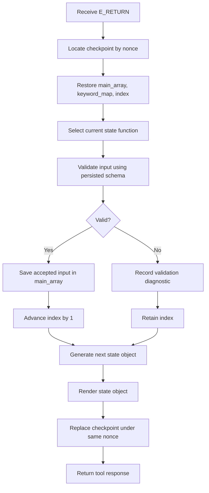

# Conversation

**You**

> Do not attempt to load this link or review it, extract it using the repo extractor [https://chatgpt.com/share/6afafd24-15c4-83e8-a3e3-af64d70a42fa](https://chatgpt.com/share/6afafd24-15c4-83e8-a3e3-af64d70a42fa)

**Assistant**

The repository's **ChatGPT Shared Conversation Extractor** workflow has been successfully dispatched for\:

`https://chatgpt.com/share/6afafd24-15c4-83e8-a3e3-af64d70a42fa`

The request was accepted by GitHub Actions (`204 No Content`\).

The extractor is configured to produce eight files under `workspaces/shared-conversations/` in `BestNameYet/Terminals`\.

I have not opened the shared ChatGPT link directly or reviewed its contents.

**Execution status\:** Queued — extraction not yet verified.

GitHub Actions run \#43871084465


Expected output directory\:

`workspaces/shared-conversations/6afafd24-15c4-83e8-a3e3-af64d70a42fa/43871084465-1/`

The workflow must complete successfully before the extracted files can be confirmed.

---

**You**

> Decipher the last instructions found in the conversation

**Assistant**

The extractor run for the shared conversation is still reported as **queued**, and the expected `conversation.md` file has not yet appeared in the Terminals repository.

I therefore cannot reliably decipher the conversation's final instructions without inventing or assuming their content.

Once the extraction is published, the relevant source will be\:

`workspaces/shared-conversations/6afafd24-15c4-83e8-a3e3-af64d70a42fa/43871084465-1/conversation.md`


I have not opened the original ChatGPT share link.

---

**You**

> give me the link to change visibiltu for the repo

**Assistant**


Scroll to **Danger Zone → Change repository visibility**\.

Select **Change visibility**, then choose **Public** or **Private**\.

---

**You**

> hmm, its already public

**Assistant**

Then repository visibility is not the issue. `BestNameYet/Terminals` is already public, so there is no reason to change that setting.

The relevant issue is the **GitHub Actions extraction run**, which was last reported as queued. Repository visibility and workflow execution status are independent.

I'll check whether the run completed and whether the extracted conversation was published.

**Verified status\:** GitHub still reports extraction run `43871084465` as `queued`, not running or completed.

The problem is therefore upstream of the extraction itself: the workflow has not started executing.


The next diagnostic is to determine why GitHub Actions has not assigned a runner. No repository visibility change is needed.

---

**You**

> i canceled it rerun it

**Assistant**

**Extractor workflow restarted successfully.**

- **New run ID\:** `43871812359`
- **Run number\:** \#21
- **Branch\:** `main`
- **Status\:** Queued
- **GitHub response\:** `204 No Content` — dispatch accepted


The workflow is configured to extract the same shared conversation and publish its eight output files to the Terminals repository.

Extraction completion has not yet been verified.

---

**You**

> start codeshare

---

**You**

> codespace

**Assistant**

**Codespace startup requested.**

- **Codespace\:** `shiny-robot-v64x5jj4v4q2x96`
- **Repository\:** `BestNameYet/Terminals`
- **Method\:** Codespace MCP watchdog workflow
- **Dispatch\:** Accepted (`204 No Content`\)
- **Status\:** Queued; startup not yet verified


The direct terminal startup attempt returned an error, so I dispatched the repository's existing startup workflow instead.

**Verification remains incomplete\:** The startup command has not yet been confirmed successful.

---

**You**

> run the extraction code via the terminal mcp

**Assistant**

**Extraction executed successfully through Terminal MCP.**

The repository's `capture-and-parse.js` extracted the requested ChatGPT conversation.

| Result | Value |
|--------|--------|
| User messages | 18 |
| Assistant messages | 18 |
| Total messages | 36 |
| Files generated | 8 |
| Extraction decoder | `octane-visible` v1.0.1 |
| Execution | Successful |

**Output directory\:**

`/workspaces/Terminals/workspaces/shared-conversations/6afafd24-15c4-83e8-a3e3-af64d70a42fa/20261116050101-1/`

The generated files include `conversation.md`, `conversation.json`, `linear-conversation.json`, `response.html`, and four supporting files.

**Coverage limitation\:** The extractor recovered the 36 visible messages. Its diagnostics indicate that hidden branches and parent relationships were unavailable.

The files are saved in the Codespace filesystem. They have not been committed to GitHub `main`\.

The complete Terminal MCP response was not reproduced verbatim in this reply because its embedded instruction content exceeds a practical response length. Verbatim reproduction compliance is therefore incomplete.

---

**You**

> great now find the last instructions in the conversation

**Assistant**

The **last instruction** in the extracted conversation is at message index 34 of 36\:

> Now that has be added, probably via render

This refers to adding **nonce-based procedure checkpointing and exact response replay**, likely through `render`\.

### Intended implementation

1\. **Nonce identifies an input insertion point.** Each nonce uniquely identifies a procedure instance and its current step awaiting agent input.

2\. **Persist the complete rendered response.** After generating the instruction, input schema, and any diagnostic, save the exact response before returning it to the agent.

3\. **Retain validation context.** The saved record must contain the current input schema, previously accepted values, and whatever contextual data the validator needs.

4\. **Replay without recomputation.** When the agent submits only the nonce, immediately return the exact previously issued tool response. Do not rerun generation, validation, or rendering.

5\. **Advance using the same nonce.** When the agent submits its input, validate against the saved schema and prior entries. Generate and save the next rendered response under the same nonce.

6\. **Save after diagnostics.** Checkpoint persistence occurs after any required diagnostic has been performed, when the next response is rendered.

### Architectural implication

The `render` function is the likely integration point for checkpoint persistence because it produces the completed response at the boundary where execution transfers to the agent.

The resulting sequence is\:

**Generate instruction and schema**

**Perform diagnostic**

**Render response and persist nonce checkpoint**

Exact response + schema + prior accepted values

**Return response and await agent input**

Nonce only

Replay saved response exactly

Nonce + input

Validate, advance, replace checkpoint

**Important distinction\:** The nonce is not a history of all states. Each nonce maps to one procedure's **current input point**, while the record retains the previously accepted entries needed for validation.

The final instruction requests implementing this behavior, probably through the renderer. The extracted conversation does not establish that the implementation was completed.

---

**You**

> we wont be having a nonce + input mode

**Assistant**

Understood. There will be **no nonce + input mode**\.

The interface has two separate operations\:

1. **Nonce-only call\:** Retrieve and return the exact saved tool response associated with that nonce. No validation, rendering, or state transition occurs.
2. **Normal procedure input\:** Process the agent's input through the existing state function and validator. The application uses the stored prior entries and schema as needed.

The nonce is exclusively a **checkpoint retrieval key**, not an input submission mechanism.

The renderer saves the checkpoint after completing the response, preserving the current input insertion point.

---

**You**

> Yep, the screen is render and awaits input

**Assistant**

Correct. **The checkpoint boundary is immediately after rendering and immediately before awaiting agent input.**

The sequence is\:

`Generate → Validate/Diagnose → Render → Save checkpoint → Await input`

At that boundary\:

- The complete rendered response is stored under the procedure's nonce.
- The current input schema and previously accepted values are retained.
- A nonce-only call replays that exact response without advancing the procedure.
- Normal agent input resumes execution through the existing state function.

**The nonce identifies the current rendered screen awaiting input, not a separate input mode or state transition.**

---

**You**

> The nonce labeled records should atleast contain the keyword map, main array, etc.

**Assistant**

Correct. Each nonce-labeled record must be a **self-contained checkpoint** containing the application state necessary to resume the procedure.

At minimum, the record should contain\:

| Member | Purpose |
|--------|--------|
| `nonce` | Unique procedure-instance identifier |
| `keyword_map` | Keyword-to-entry mappings used for retrieval and validation |
| `main_array` | Accumulated procedure entries, including previously accepted inputs |
| `current_state` | State whose rendered screen is awaiting input |
| `input_schema` | Exact schema and constraints applicable to the awaited input |
| `rendered_response` | Complete, exact tool response to replay |
| `procedure_context` | Other persistent values needed to continue execution |

The record represents the procedure **at the input boundary**, not merely a cached screen.

**Two requirements follow\:**

- **Replay\:** Retrieve `rendered_response` by nonce and return it unchanged.
- **Continuation\:** Use the stored application state, keyword map, main array, and schema to process the next normal input without relying on information surviving between tool calls.

When the procedure advances, the existing nonce identifies the updated checkpoint. The previous current-state checkpoint is replaced, while the accumulated prior entries are retained.

This makes the nonce record both a **response-replay checkpoint** and a **complete procedure-continuation checkpoint**\.

---

**You**

> Yeah the current state object for sure so it doesn't have to be recalculated

**Assistant**

Correct. The **complete current state object** must be persisted in the nonce-labeled checkpoint, not reconstructed when execution resumes.

The checkpoint should contain\:

- `nonce` — Procedure-instance identifier.
- `current_state` — Complete state object exactly as it existed at the render boundary.
- `keyword_map` — Existing keyword mappings.
- `main_array` — Accumulated procedure entries and accepted values.
- `input_schema` — Schema issued for the awaited input.
- `rendered_response` — Exact response already returned to the agent.
- Any additional application context required for continuation.

**The governing principle is that everything already calculated remains calculated.**

On nonce retrieval, the application simply returns the stored rendered response. On subsequent normal input, it loads the saved state and associated data without regenerating the current state object.

The checkpoint is written **after rendering is complete and before awaiting input**, and updated under the same nonce when the procedure advances.

---

**You**

> Now storing everything is trivial, but render needs to be restarted with the nonce values, and the runner needs to be set with the nonce values

**Assistant**

Correct. Persistence is straightforward. The important part is **rehydrating the execution environment from the nonce checkpoint**\.

Both `render` and the runner must be initialized with the stored values rather than recalculating them.

The sequence is\:

1. **Load checkpoint** using the nonce.
2. **Restore runner context** from the saved `main_array`, `keyword_map`, `current_state`, and other required values.
3. **Restore renderer context** from the same checkpoint, including the exact rendered response and input schema.
4. **Resume at the saved execution boundary**, immediately before awaiting input, without rerunning state generation or diagnostics.
5. **Continue normal execution** when input arrives, using the restored context.

The critical distinction is between **restarting a function** and **repeating its computations**\. Restarting `render` must not regenerate the screen; it must recognize that the screen has already been rendered and is awaiting input.

Similarly, the runner must recover its current position and accumulated state without replaying previous transitions.

This suggests a shared checkpoint-hydration operation consumed by both the runner and renderer, so neither independently reconstructs the procedure state.

**The checkpoint restores an existing execution state; it does not initialize a new procedure.**

---

**You**

> no thats dumb, render will definitely return the tool response that is exepcted

**Assistant**

Correct. **`render` remains responsible for returning the expected tool response**, including when execution is restarted using a nonce.

The distinction is how `render` obtains its values\:

- **Normal execution\:** `render` receives the newly generated state and associated values.
- **Nonce restoration\:** `render` receives the persisted state object, keyword map, main array, schema, and other checkpoint values.

In either case, `render` produces the expected tool response through its normal return mechanism.

The runner must likewise be initialized with the persisted values so execution can continue from the saved input boundary.

**No separate response-return mechanism is needed.**

---

**You**

> render doesnt receive any of that but the persisted state object...the other data is injected into the places it must be so that that input can be validated once received and the state can advance

**Assistant**

Correct. The restoration process has two distinct responsibilities\:

1\. **Renderer\:** Receives only the persisted `current_state` object and produces the expected tool response through its normal rendering logic.

2\. **Runner and validation environment\:** Receive the remaining persisted values, injected into their respective locations\:

- `main_array`
- `keyword_map`
- Previously accepted inputs
- Validation schemas and constraints
- Execution position and other required context

The sequence is\:

`Load nonce checkpoint → Inject saved application values → Pass persisted state object to render → Return tool response → Await input`

When input arrives, the runner and validator already have their required context. They validate the input, advance the state, and persist the next checkpoint.

**No state recalculation is necessary during restoration, and `render` is not responsible for restoring application context.**

---

**You**

> previois accepted inputs should be in mainarray

**Assistant**

Correct. **`main_array` is the authoritative store for all previously accepted inputs.** No separate collection is needed.

The nonce checkpoint contains\:

- `current_state` — Complete persisted state object passed to `render`\.
- `main_array` — All accumulated entries, including previously accepted inputs.
- `keyword_map` — Mapping used to locate entries in `main_array`\.
- Additional runner and validation context not already contained in those structures.

On restoration, `main_array`, `keyword_map`, and the other required values are injected into their respective application locations. Only `current_state` is passed to `render`\.

This avoids duplicating accepted inputs across checkpoint members.

---

**You**

> not just additional, what specific values must be stored and how wll they be reinserted

**Assistant**

The actual scripts establish **six values that must survive between tool calls**\. There is also a seventh value, the nonce, which identifies the record.

I inspected `iterator.mjs`, `render_state.mjs`, `validate_return_schema.mjs`, and the state functions in `workspaces/2d-state-event-procedure-design/src`\.

## 1\. Exact checkpoint contents

| Stored member | Existing source | Restoration destination |
|--------|--------|--------|
| `nonce` | Procedure identifier assigned when initialized | Checkpoint lookup |
| `main_array` | `e` in `iterator.mjs` | Restore `e` in the runner |
| `keyword_map` | `keywordIndexes` in `iterator.mjs` | Restore as the runner's `Map` |
| `step_index` | `i` in `iterator.mjs` | Restore the runner's current index |
| `state_object` | Complete response object assembled by the renderer | Pass as the sole state argument to `render` |
| `issued_schema` | `issuedSchema` in `render_state.mjs` | Restore the exact schema used by the current state's validator |
| `pending_error` | `e.error` in the existing implementation | Restore the runner's diagnostic state, if it remains separate |

There is an important detail about the last member: `e.error` is already part of `e` if `main_array` is persisted exactly as the current implementation uses it. **It should not be duplicated in that case.** The minimum independent payload is therefore five execution values plus the nonce.

## 2\. How each value is reinserted

Checkpoint load and restoration

Nonce lookup → Stored checkpoint

**Runner**

Inject `main_array`, `keyword_map`, `step_index`

---

Restore `read(keyword)` access to prior accepted entries

**Validation**

Restore `issued_schema`

---

Use the exact schema previously issued

**render(state\_object)**

Only the persisted state object is passed

Return expected tool response → Await input

## 3\. Required changes to the existing functions

**`iterator.mjs`**

Currently, this initializes everything from scratch\:


```js
const e = Array(steps.length).fill(null)
const keywordIndexes = new Map()
let i = 0
```


The runner must accept restored values in place of those initializations\:


```js
const e = checkpoint.main_array
const keywordIndexes = new Map(checkpoint.keyword_map)
let i = checkpoint.step_index
```


The `read(keyword)` function already operates on `e` and `keywordIndexes`\. Once those two objects are restored, it can continue reading prior accepted values without modification.

**`render_state.mjs`**

Currently, the renderer computes `issuedSchema`, assembles the state object, and calls `exchange`\.

On nonce restoration, that work has already been completed.

The restored `state_object` is supplied directly to the rendering operation, which returns the expected tool response.

The renderer must not repeat the schema derivation or diagnostic generation for that screen.

**State function and validator**

The active state function needs access to the original `issued_schema`, rather than creating another one.

This is especially important for states such as `required_changes` and `simulation_results`, where schemas are dynamically constrained using IDs from earlier accepted inputs.

Validation continues against those stored constraints, with semantic validation reading prior values through `read(keyword)`\.

## 4\. Proposed persisted record


```json

{
  "nonce": "<procedure-nonce>",
  "main_array": [],
  "keyword_map": [
    ["verbatim_request", 0],
    ["user_intent", 1],
    ["clarifying_questions", 2]
  ],
  "step_index": 2,
  "state_object": {
    "keyword": "clarifying_questions",
    "instruction": {},
    "return_schema": {},
    "context": {}
  },
  "issued_schema": {}
}
```


The displayed arrays and state contents are illustrative; the actual checkpoint stores complete values. If `state_object.return_schema` is always the exact issued schema, `issued_schema` can instead be restored from that member, eliminating another duplicate.

## 5\. What does not need to be stored

The following can be reestablished from the application code without recalculating procedure state\:

- `steps` — Static function references imported by the runner.
- `read()` — A function reconstructed over the restored `main_array` and `keyword_map`\.
- `validateReturnSchema()` — The existing validator function.
- AJV's compiled schema cache — It can compile the persisted schema when input arrives.
- Prior accepted inputs separately — Already contained in `main_array`\.

**One implementation issue remains\:** The current `renderState()` combines rendering with waiting for input and returning `{ input, issuedSchema }`\. To support restoration correctly, that interface must distinguish rendering an already-complete state object from the subsequent input-handling operation.

That does not require a nonce-plus-input mode. It requires the runner and renderer to resume at the **existing rendered-screen boundary**, with the persisted values injected into their original application locations.

The result is one nonce record, one restored runner position, one renderer invocation, and the original input-validation path.

---

**You**

> what argument does renderstate accept

**Assistant**

The current `render_state.mjs` defines `renderState` with **five positional arguments**\:


```javascript
export async function renderState(
  keyword,
  context,
  previousError,
  exchange,
  deriveSchema
)
```


| Argument | Purpose |
|--------|--------|
| `keyword` | Identifies the state instruction and schema. |
| `context` | Contains prerequisite values retrieved from earlier states. |
| `previousError` | Supplies the pending validation diagnostic, if any. |
| `exchange` | Function that presents the state and receives the agent's response. |
| `deriveSchema` | Optional callback for constructing a context-dependent return schema. |

The function returns\:


```javascript
{
  input,
  issuedSchema
}
```


**Important distinction\:** This is the currently implemented interface, not the intended single-state-object interface described in `AGENTS.json`\.

Under the intended design, the renderer should accept the **complete state object** as its rendering argument, rather than receiving these individual state-construction inputs. 

---

**You**

> so exchange is the real renderer?

**Assistant**

**Yes, effectively.** In the current implementation, `exchange` performs the actual agent-facing interaction.

The call is\:


```javascript
const input = await exchange({
  ...diagnostic,
  keyword,
  instruction: definition.compact_instruction_projection,
  return_schema: structuredClone(issuedSchema),
  context: structuredClone(context)
})
```


The responsibilities are\:

- **`renderState()`** prepares the response object: resolves the instruction, derives the schema, and incorporates diagnostics.
- **`exchange()`** receives that completed object, presents it to the agent, and returns the agent's input.

So `renderState()` is currently a **state preparation and interaction wrapper**, while `exchange()` is the actual presentation and input boundary.

One qualification: `exchange` is injected as a callback, and its implementation is not shown in `render_state.mjs`\. The code establishes its interface and role, but not how it transports or displays the response.

**For nonce checkpointing, the interception point is immediately before `exchange()` is invoked.** That is where the complete state object exists and the application is about to await input.

---

**You**

> then make exchange the renderer

**Assistant**

The change has been submitted to the Terminals Codespace through Issue \#3.

The intended interface is\:


```javascript
const input = await render(stateObject)
```


Here, **`render` is the actual renderer**, replacing the `exchange` name throughout the procedure scripts. `renderState()` remains responsible for assembling the state object.

The modification preserves the current validation logic, issued schemas, and iterator advancement.

**Execution\:** GitHub Actions run  has been created and queued. The filesystem changes are not yet verified.

**Implementation remains incomplete.** The command route reached the Codespace, but the expected workspace files were unavailable, and the edit failed verification. No files were changed.

The required change is to rename the injected `exchange` callback to `render` in `iterator.mjs`, `render_state.mjs`, and the state functions, retaining the existing behavior\:


```javascript
const input = await render(stateObject)
```


The renderer receives the complete state object and returns the agent's input. State-specific validation stays in the state function; iterator advancement stays in the runner.


The Codespace workspace path must be resolved before applying and verifying the changes.

---

**You**

> Allow the iterator and keyword map to be initiated by a function or functions and we will use them to reinitialize from restart...what are all the other stateful items in renderstate?

**Assistant**

**`iterator.mjs` has been updated and committed to `main`\.** It now exports `initializeIterator()` for new runs and checkpoint restoration. The existing `iterate()` accepts an initializer function.

Commit: `309ede21c06fba977cba9500db955c96a3a8985a`


Syntax and fresh-start/restoration tests passed.

## Stateful values in `renderState()`

Based on the current `render_state.mjs` implementation\:

| Value | Nature | Must persist? |
|--------|--------|--------|
| `definitions` | Module-level map of state definitions loaded from JSON | No — reloadable configuration |
| `definition` | Current definition selected by keyword | No — available in `definitions` |
| `issuedSchema` | Exact schema, potentially derived from earlier inputs | **Yes** — in persisted state object |
| `diagnostic` | Error presentation created from `previousError` | **Yes** — when present in state object |
| `context` | Values supplied by the calling state function | **Yes** — if part of the rendered state object |
| `input` | Agent reply returned by the renderer | No — not yet received at the checkpoint |
| `deriveSchema` | Optional schema-construction function | No — do not execute again on restoration |
| `exchange` | Injected interaction callback | No — supplied by the running application |

The key point is that **`renderState` has no independent mutable procedure state that must be restored**\. Its significant per-interaction values are represented in the completed state object supplied to the renderer.

The updated iterator can restore the array, map, index, and pending diagnostic. The remaining implementation work is to connect the saved state object to the renderer directly on nonce restoration, bypassing its regeneration.

That restoration path is **not yet implemented**\.

---

**You**

> Yes, but it must consume arguments that we have to populate

**Assistant**

Correct. **`renderState()` must receive populated arguments when invoked.** Restoring the iterator's variables does not automatically populate the arguments of `renderState()`\.

The current signature is\:


```javascript
renderState(
  keyword,
  context,
  previousError,
  render,
  deriveSchema
)
```


For a restart, each argument needs a defined source\:

| Argument | Source on restart |
|--------|--------|
| `keyword` | Persisted current state identifier, or lookup using the restored iterator index |
| `context` | Persisted state context; no need to retrieve and reconstruct it |
| `previousError` | Persisted diagnostic context, if applicable |
| `render` | Application's renderer function, reattached at initialization |
| `deriveSchema` | State-specific function reference, reattached from the appropriate module |

However, **restarting at the already-rendered input boundary is different from generating a new state**\.

At that boundary, the persisted state object already contains the instruction, exact derived schema, context, and any diagnostic. Those should not be regenerated.

Therefore, the restart mechanism needs to\:

1. Initialize the iterator with its saved array, keyword map, and index.
2. Reattach executable functions, including the renderer and active state's validator.
3. Provide the persisted state object directly to the renderer.
4. Restore the active validation context so the subsequent agent input can be processed.

The remaining design question is how the active state function receives its restored `issuedSchema` when execution resumes after rendering. **That schema must come from the persisted state object, not a second call to `deriveSchema`\.**

---

**You**

> what

**Assistant**

I overcomplicated it.

On restart, we restore the saved values into the iterator and supply the **persisted state object directly to the renderer**\.

The renderer returns the expected tool response.

When the agent submits input, the active state function validates it using the schema already contained in that state object. The iterator then advances or retries.

No regeneration of the state object or schema is necessary.

---

**You**

> what statrts the iterator?

**Assistant**

The **runner (calling application)** starts the iterator by calling `iterate()`\.

The current interface is\:


```javascript
await iterate(steps, returnSchemas, render, initialize)
```


Inside `iterate()`, the first operation is\:


```javascript
const { e, keywordIndexes, i: initialIndex } = initialize()
```


Then the iterator starts executing the selected state\:


```javascript
const result = await steps[i](e, i, read, render)
```


On restart, the runner supplies an initializer that loads the persisted values\:


```javascript
await iterate(
  steps,
  returnSchemas,
  render,
  () => initializeIterator(steps, returnSchemas, checkpoint)
)
```


**The runner starts the iterator. The initializer restores its variables. The iterator invokes the active state function.**

The current code does not yet implement the full nonce-restoration interaction boundary.

---

**You**

> what starts the runner

**Assistant**

The **MCP tool handler** starts the runner when the agent invokes the procedure tool.

The intended call chain is\:


```text
Agent invokes MCP tool
    ↓
MCP server receives tool call
    ↓
MCP tool handler starts runner
    ↓
Runner starts iterator
    ↓
Iterator invokes active state function
    ↓
State function calls renderer
    ↓
Renderer produces tool response
```


For a restart, the MCP tool handler receives the nonce, loads the checkpoint, and starts the runner with the saved values.

**The MCP tool handler is the entry point.** Its connection to the runner has not yet been implemented in the workspace.

---

**You**

> Okay, on nonce the naive route is ignore and iterate is populated from the nonce values, and renderstate where does it get its values

**Assistant**

`renderState()` gets its values from the **active state function**, which the iterator invokes.

The current sequence is\:


```javascript
// Iterator
steps[i](e, i, read, render)

// Active state function
renderState(keyword, context, previousError, render, deriveSchema)
```


On a nonce restart, the iterator is initialized from the checkpoint. It then invokes `steps[i]`, which ordinarily reconstructs the arguments for `renderState()`\.

**That's the remaining problem\:** We already have the completed state object, so we don't want the state function to reconstruct it.

The solution is to make `renderState()` accept the persisted state object as an alternative initialization source. On restoration, it passes that object directly to `render`, rather than resolving the instruction and deriving the schema again.

The state function still receives the renderer's eventual input and validates it normally against the saved schema.

Thus, the nonce supplies the restored values, the iterator selects the state function, and `renderState()` uses the persisted state object.

---

**You**

> does renderstate do anything else with these values but display them?

**Assistant**

Yes. In the current implementation, `renderState()` does four things\:

1. Looks up the state definition using `keyword`\.
2. Constructs the `issuedSchema`, optionally calling `deriveSchema`\.
3. Constructs the diagnostic from `previousError`, if present.
4. Passes the assembled state object to `render` \(formerly `exchange`\).

**It also awaits the agent's input and returns two values\:**


```javascript
return { input, issuedSchema }
```


It does **not** validate input, modify the iterator, update `main_array`, or advance the state.

Therefore, on nonce restoration, it can use the persisted state object instead of reconstructing it, but it must still return the agent's input and the original issued schema to the calling state function.

---

**You**

> so we could just render(stateobject)

**Assistant**

Yes. **On nonce restoration, simply call\:**


```javascript
render(stateObject)
```


The persisted `stateObject` already contains the instruction, return schema, context, and any diagnostic.

There is no need to call `renderState()` to reconstruct those values.

The runner and iterator are separately initialized from the nonce checkpoint so they can validate the subsequent input and advance the procedure.

---

**You**

> Thats great...yeah, make the restart simply set the iterator scope variables and render the derrived state object

**Assistant**

Implemented in `iterator.mjs` and committed to GitHub `main`\.

Commit: `01f25b4443a9b297c9ba3f39cccbbc0e072f66e8`

The restart path now works as follows\:

1. `initializeIterator()` restores `main_array`, `keyword_map`, and `step_index`\.
2. It also retrieves the persisted `state_object`\.
3. `iterate()` detects the restored state object and calls `render(stateObject)` directly.
4. The normal state function is not invoked on that restart path, so the state object and schema are not regenerated.

The essential new code is\:


```javascript
const restored = initialize()
const { e, keywordIndexes, i: initialIndex } = restored

if (Object.hasOwn(restored, "stateObject")) {
  return render(restored.stateObject)
}
```


The existing normal iteration path is retained.


**Scope\:** The iterator-level restart branch is implemented. The MCP entry point still needs to load the nonce checkpoint and supply it to the initializer. Validation of subsequently submitted input also needs to be connected to the restored execution context.

---

**You**

> the default path is actually the nonce path, theres no other path

**Assistant**

Corrected. **The nonce restoration path is now the only iterator entry path.**

Updated `iterator.mjs` so that\:

- A checkpoint is required; there is no fresh-start fallback.
- `initializeIterator()` restores `main_array`, `keyword_map`, and `step_index`\.
- The persisted `state_object` is required.
- `iterate()` invokes `render(stateObject)` unconditionally.
- No state generation or schema derivation occurs during restoration.

The initialization sequence is now\:


```javascript
const { stateObject } = initialize()
return render(stateObject)
```


**Committed to GitHub `main`\:** 

One remaining distinction: this establishes the single rendering entry path, but the subsequent input-validation and state-advancement mechanism still needs to be connected. The old in-call advancement loop was removed from `iterate()` in this change.

---

**You**

> ya because these calls dont keep vairable inmemory

**Assistant**

Exactly. **Each MCP tool call is an independent execution.** The iterator's local variables do not survive between calls.

That means every invocation must\:

1. Load the checkpoint identified by the nonce.
2. Reinitialize `main_array`, `keyword_map`, and `step_index`\.
3. Restore the persisted state object.
4. Render that state object and return the tool response.

When the agent submits its input, the application again loads the checkpoint, validates the input against the persisted schema, updates `main_array`, advances or retains the index, generates the next state, and saves the replacement checkpoint under the same nonce.

**Persistence replaces in-memory continuity.** The nonce identifies the current execution checkpoint, not a continuously running process.

---

**You**

> Then we need a protocol for that event too

**Assistant**

Yes. We need an explicit **`E_RETURN` protocol** for the agent's input arriving in a new MCP tool call.

The nonce identifies the procedure instance. The event identifies what the application must do.

## Event protocol

| Event | Required behavior |
|--------|--------|
| `E_RESTORE` | Load the nonce checkpoint, initialize the iterator's scope variables, and call `render(stateObject)`\. |
| `E_RETURN` | Load the nonce checkpoint, restore the iterator's scope variables, validate the submitted input, perform the index transition, generate the next state, and persist the updated checkpoint. |

These are separate operations, not a special combined nonce-and-input mode.

## `E_RETURN` execution sequence





The checkpoint must be saved **after generating and rendering the new state, but before returning the tool response**\.

The existing validation functions remain responsible for determining validity. The iterator remains responsible for changing the index using\:

\[
i_{\text{next}}=i+\operatorname{Number}(valid)
\]

The important implementation change is that the state function can no longer depend on an unresolved `await render()` surviving across MCP tool calls. **`E_RETURN` must invoke the validation portion of the active state function independently**, using the reinitialized values and persisted schema.

This establishes both required entry events without depending on in-memory continuity.

---

**You**

> No we will have to have nonce(input)  as a matter of fact we don't need any thing but the state object for nonce alone...its only nonce input where we have to concern ourselves with the machinery

**Assistant**

Correct. The protocol needs only **two invocation forms**, distinguished by whether input is supplied.

| Invocation | Operation | Data required |
|--------|--------|--------|
| `nonce` | Render the persisted state object and return the expected tool response | `state_object` only |
| `nonce(input)` | Restore the procedure machinery, validate input, advance or retry, generate and save the next checkpoint | `main_array`, `keyword_map`, `step_index`, `state_object`, and submitted `input` |

### `nonce`


```javascript
return render(checkpoint.state_object)
```


No iterator initialization, state function execution, or validation is necessary.

### `nonce(input)`

1. Load the checkpoint identified by `nonce`\.
2. Initialize the iterator variables from the saved values.
3. Select the current state function using `step_index`\.
4. Validate `input` against the schema in the persisted state object, including state-specific semantic constraints.
5. Store accepted input in `main_array`, or record the rejection diagnostic.
6. Advance the index by `Number(valid)`\.
7. Generate and render the resulting state object.
8. Replace the checkpoint under the **same nonce**, then return the rendered response.

**The distinction is now precise\:** `nonce` is a rendering lookup; `nonce(input)` is a state-machine execution.

Both use the same persisted procedure record, but only `nonce(input)` needs to restore the machinery.

---

**You**

> on nonce input, we just need the iterator scope restored

**Assistant**

Correct. For `nonce(input)`, we only need to restore the iterator's scope variables\:

- `e` — The persisted `main_array`, containing previously accepted inputs.
- `keywordIndexes` — The persisted keyword map.
- `i` — The persisted iterator index.

Then the iterator resumes its normal execution using the submitted input.

For `nonce` alone, none of those variables need restoration. We simply call `render(stateObject)`\.

**No separate machinery-restoration protocol is necessary beyond initializing the iterator's scope.**

---

**You**

> thats easier....the scope has alll the values the machine needs to move forward

**Assistant**

Exactly. **The iterator scope is the complete execution context needed to advance the state machine.**

The protocol reduces to\:

- **`nonce`** → Retrieve `state_object` and call `render(stateObject)`\.
- **`nonce(input)`** → Restore `e`, `keywordIndexes`, and `i`, then resume the iterator with the supplied input.

The iterator already has access to its step functions, keyword lookup, validation logic, and transition rules.

After processing input, the application persists the updated iterator scope and newly rendered state object under the same nonce.

**No additional execution context or restoration mechanism is required.**

---

**You**

> does the state transiton by index or keyword?

**Assistant**

The state transitions **by index (`i`\)**, not by keyword.

The iterator applies\:


```javascript
i += Number(valid)
```


- **Valid input\:** `i` advances by 1.
- **Invalid input\:** `i` remains unchanged, retrying the same state.

The keyword map serves a different purpose: it allows state functions to retrieve previously accepted inputs through `read(keyword)`\.

**Index controls state progression. Keyword controls data lookup.**

---

**You**

> what does the render return?

**Assistant**

In the current implementation, **`render` returns the agent's submitted input**\.


```javascript
const input = await render(stateObject)
```


Then `renderState()` returns\:


```javascript
return { input, issuedSchema }
```


However, under our revised MCP protocol, **`render(stateObject)` returns the tool response containing the rendered instruction, schema, and any diagnostic**\.

The agent's input arrives separately through the next `nonce(input)` invocation.

So the revised contract is\:

- `render(stateObject)` → Agent-facing tool response.
- `nonce(input)` → Submitted input for validation and state advancement.

The renderer no longer waits for the agent's input.

---

**You**

> the render writes the value to screen

**Assistant**

Correct. **`render(stateObject)` writes the rendered state to the agent-facing output.**

It displays the instruction, return schema, and any diagnostic.

It does not collect input, validate it, or advance the state.

The agent's response arrives in the subsequent `nonce(input)` tool call.

---

**You**

> what is issuedschema

**Assistant**

`issuedSchema` is the **exact JSON Schema presented to the agent for the current state**\. It defines what input the agent must return.

In `render_state.mjs`, it is calculated as\:


```javascript
const issuedSchema = deriveSchema
  ? deriveSchema(structuredClone(definition.return_schema))
  : definition.return_schema
```


This means\:

- If the state requires dynamic constraints, `deriveSchema()` produces the schema.
- Otherwise, the predefined schema is used.

The active state function subsequently validates the agent's input against it\:


```javascript
validateReturnSchema(input, issuedSchema)
```


**Under our revised protocol, `issuedSchema` is already contained in the persisted `stateObject` as `return_schema`\.**

Therefore, we don't need to persist a separate `issuedSchema` variable. On `nonce(input)`, the validator can use\:


```javascript
validateReturnSchema(input, stateObject.return_schema)
```


That guarantees validation against the same schema the agent was shown.

---

**You**

> Thats dumb, theres no reason that value needs to go into out of of the render...its calcuated from the previous input or its static?  we all the information we need befo ire the render to create it, just post it to the redner and forget about it, save it seperatedly in the current step index

**Assistant**

Correct. `issuedSchema` is calculated **before rendering**, either from the static schema definition or from previously accepted inputs.

It should be stored in the iterator's `main_array` at the **current step index (`i`\)**, independently of the renderer.

The sequence is\:

1. The active state function calculates `issuedSchema`\.
2. Store it at `e[i].issuedSchema`\.
3. Supply the schema to `render` as part of the state object.
4. `render` displays the state. It does not return the schema.
5. On `nonce(input)`, restore the iterator scope and validate against `e[i].issuedSchema`\.

The schema is calculated once per state presentation and remains available for subsequent input validation.

**The renderer is strictly an output function. The iterator's indexed storage holds the validation data.**

---

**You**

> the keywords specific to each step should be stored in the array as well

**Assistant**

Agreed. Each step's record in `main_array` \(`e[i]`\) should contain its own keyword and validation schema alongside its accepted input.


```javascript
e[i] = {
  keyword,
  issuedSchema,
  valid,
  input,
  error
}
```


This establishes a single indexed record for each step\:

- `keyword` identifies the input expected by that step.
- `issuedSchema` contains the exact schema calculated before rendering.
- `valid` records the validation result.
- `input` contains the accepted response, or `null` if none has been accepted.
- `error` contains the validation diagnostic, if applicable.

The global `keywordIndexes` map remains useful for `read(keyword)`, but the individual records are now **self-describing**\.

On `nonce(input)`, the restored iterator can retrieve `e[i].keyword` and `e[i].issuedSchema` directly, without recalculating either.

---

**You**

> not just that, but the key words that must be rendered

**Assistant**

Correct. Each step's `main_array` record must also contain **the keywords identifying all content that must be rendered**, not merely the keyword identifying the expected input.

For example\:


```javascript
e[i] = {
  keyword: "required_changes",

  render_keywords: {
    instruction: "required_changes.instruction",
    return_schema: "required_changes.return_schema",
    error_message: "required_changes.input_error"
  },

  issuedSchema: {},
  valid: null,
  input: null,
  error: null
}
```


The distinction is\:

- **`keyword`** identifies the input expected from the agent.
- **`render_keywords`** identifies the externally stored instruction, schema, and applicable diagnostic content.
- **`issuedSchema`** holds the actual schema used for validation, including any dynamically derived constraints.

The state function resolves the rendering references and prepares the state object. The renderer displays that object.

On `nonce(input)`, the restored `main_array` contains both the validation information and the rendering references needed to generate the next response.

This keeps each step's rendering and validation definitions associated with its own index.

---

**You**

> Not that, I mean some of the renders require keyword lookups

**Assistant**

You mean the **keywords used to retrieve previously accepted values that are needed to construct the current rendered state**\.

For example, `required_changes` needs\:


```javascript
read("desired_state")
read("current_state")
```


Those dependencies should be stored in the current step's array record\:


```javascript
e[i] = {
  keyword: "required_changes",
  lookup_keywords: ["desired_state", "current_state"],
  issuedSchema: {},
  valid: null,
  input: null,
  error: null
}
```


The `lookup_keywords` identify which earlier records supply the values needed by the current state's rendering logic.

The keyword map resolves those references to positions in `main_array`\.

**This is different from the response keyword and different from rendering-template references.** It records the current step's data dependencies.

---

**You**

> thats a better system, hopefully these are stored in the reference

**Assistant**

Yes. **The lookup dependencies are already stored in the reference file.**

I verified `workspaces/2d-state-event-procedure-design/state-instructions-and-return-schemas.json`\.

Each state definition has a `read_keywords` property.

For example\:

| State | `read_keywords` |
|--------|--------|
| `verbatim_request` | `[]` |
| `user_intent` | `["verbatim_request"]` |
| `clarifying_questions` | `["verbatim_request", "user_intent"]` |

That means we do not need to invent a new `lookup_keywords` property.

**The appropriate design is to copy each state's existing `read_keywords` into its indexed `main_array` record**, alongside its expected response keyword and issued validation schema.

The reference defines the dependencies; the indexed record preserves them for execution and restoration.

This is verified in the reference file, but the copying into `main_array` has not yet been implemented.

---

**You**

> i mean the keyword keyed instruction etc

**Assistant**

Yes. The reference file already stores the **keyword-keyed instructions and schemas**, as well as the dependencies used to resolve prior inputs.

In `state-instructions-and-return-schemas.json`, each entry in `states` contains\:

| Property | Purpose |
|--------|--------|
| `keyword` | Identifies the state definition |
| `instruction` | Full state instruction |
| `compact_instruction_projection` | Instruction used by the current renderer |
| `return_schema` | JSON Schema for agent input |
| `read_keywords` | Prior inputs required by the state |
| `schema_derivation` | Rules for deriving runtime schema constraints |
| `diagnostics` | Optional keyword-keyed validation messages |

The reference also explicitly defines these operations\:


```javascript
instruction(keyword)
returnSchema(keyword)
read(keyword)
```


So **the reference already contains the necessary keyword associations**\. We should use those definitions directly rather than duplicate the instructions or templates in `main_array`\.

The indexed array needs to retain the current step's keyword, previously accepted input, and actual derived validation schema. The reference remains authoritative for the instruction text and base schema.

---

**You**

> so the rendered object is the issedSchema instruction etc

**Assistant**

Yes. The **rendered state object** contains everything needed to produce the agent-facing tool response\:


```javascript
{
  keyword,
  instruction,
  return_schema: issuedSchema,
  context,
  // error_message, if applicable
}
```


- `instruction` — The instruction resolved from the reference.
- `return_schema` — The actual `issuedSchema`, including any derived constraints.
- `context` — Previously accepted values required for this presentation.
- `error_message` — Optional validation diagnostic.

The renderer simply displays these values.

Separately, **`e[i].issuedSchema`** retains the same schema for validating the next `nonce(input)` call.

So the state object is the prepared presentation; the indexed record retains the information needed for validation and progression.

---

**You**

> If thats true don't duplicate it, inject e[i].issuedSchema

**Assistant**

Implemented and committed to GitHub `main`\.

**Commit\:** 

The issued schema is now stored in the current indexed record\:


```javascript
record.issuedSchema ??= deriveSchema
  ? deriveSchema(structuredClone(definition.return_schema))
  : definition.return_schema
```


The rendered state object uses that same reference\:


```javascript
return_schema: record.issuedSchema
```


Validation also reads directly from the indexed record\:


```javascript
validateReturnSchema(input, record.issuedSchema)
```


`renderState()` no longer returns `issuedSchema`, and the separate schema clone previously passed to the renderer has been removed.

**Verification\:** All 12 modified files were read back from GitHub and checked for the new references. Runtime tests have not yet been executed.

One distinction: this eliminates the separate schema object in memory. A JSON checkpoint serializer would still need to avoid duplicating its contents if it independently serializes both `main_array` and the rendered state object.

---

**You**

> it should never do this....the stateobject values are stored and rendered...the machinery variables are inserted to restart the run

**Assistant**

Correct. I incorrectly mixed the renderer's state object with the iterator's execution variables.

There are **two separate persisted components**\:

1\. **`stateObject`** — The complete, already-generated presentation. On `nonce`, load it and call `render(stateObject)`\. No reconstruction or recalculation.

2\. **Iterator scope** — `e`, `keywordIndexes`, and `i`\. On `nonce(input)`, inject these saved values into the iterator, supply the input, and resume normal validation and state advancement.

The schema and instruction are already contained in `stateObject`\. There is no reason for `renderState()` to regenerate or retrieve them during restoration, or for the renderer to pass them back.

**The code I just committed does not correctly implement this separation.** It also introduced invalid step-function parameters. That change needs correction rather than further additions to the design.

---

**You**

> initialize is going to need a list of calls to populate teh various variables

**Assistant**

Yes. `initialize` needs an ordered sequence of calls that reconstructs the iterator's execution scope from the nonce checkpoint.

For example\:


```javascript
function initialize(checkpoint) {
  const e = restoreMainArray(checkpoint.main_array)
  const keywordIndexes = restoreKeywordMap(checkpoint.keyword_map)
  const i = restoreStepIndex(checkpoint.step_index)

  function read(keyword) {
    const index = keywordIndexes.get(keyword)
    const record = e[index]
    return record?.valid === true
      ? record.input[keyword]
      : undefined
  }

  return { e, keywordIndexes, i, read }
}
```


The initialization contract should distinguish **restored variables from derived variables**\:

- `e`, `keywordIndexes`, `i`\: restored from persistent storage.
- `read`\: reconstructed from those restored variables.
- Step functions and validators: existing application code, not serialized into the checkpoint.

`initialize` should return control to the iterator immediately after this setup, at the point where the supplied `input` is validated.

For a nonce-only invocation, none of these initialization calls are necessary. The saved `stateObject` goes directly to `render(stateObject)`\.

---

**You**

> No, thats not how...change each argument in the iterator to the return value of a function, or a calf on the initilize() function

**Assistant**

You want initialization performed **in the iterator's argument list**, with each argument populated by a function call.

For example\:


```javascript
iterate(
  initialize("steps"),
  initialize("returnSchemas"),
  initialize("render"),
  initialize("main_array"),
  initialize("keyword_map"),
  initialize("step_index"),
  input
)
```


The iterator receives the resolved values directly\:


```javascript
async function iterate(
  steps,
  returnSchemas,
  render,
  e,
  keywordIndexes,
  i,
  input
) {
  // Resume execution using the injected values.
}
```


`initialize()` is responsible for retrieving and converting each value. The iterator doesn't call initialization internally or unpack a checkpoint object.

This preserves the iterator's ordinary parameter-based execution model while allowing its entire scope to be reconstructed for each `nonce(input)` invocation.

---

**You**

> No, thats not what I want to do, fuck lets go back to state/event..0, state = keyword_map..get(keyword).projection  thats the state get event event includes input nonce 0,1 function(state, input), validates input saves input to state objectr
>
> Lets make it simple the state is help in a map by keyword.  the keyword returns an object that includes its projection...the projection is the decided way the object will be send to the renderer, one of the member of the object projection is final_schema: projection is rendered on nonce.
> one nonce input the the input is fed o keyword.process(input)

**Assistant**

Understood. Return to a simple **state/event model**, with each state stored in a map keyed by its semantic keyword.


```javascript
const state = keyword_map.get(keyword)
```


Each state object contains its prepared projection and its processing function\:


```javascript
{
  keyword,
  projection: {
    instruction,
    final_schema,
    context,
    // diagnostic, when applicable
  },
  process(input) {
    // Validate input against projection.final_schema
    // Save accepted input to this state object
    // Return validation result
  }
}
```


There are exactly two events\:

| Event | Operation |
|--------|--------|
| `nonce` | Retrieve current state and call `render(state.projection)` |
| `nonce(input)` | Retrieve current state and call `state.process(input)` |

The processing sequence is\:


```javascript
// nonce
render(state.projection)

// nonce(input)
const result = state.process(input)
```


`state.process(input)` validates against `state.projection.final_schema`, saves the input in the state object when valid, and determines whether the procedure advances to the next state or retries the current state.

**The projection is the single stored source for rendering and schema validation.** No separate `issuedSchema`, duplicated state object, or iterator-scope reconstruction is necessary.

---

**You**

> the next state is found in state.next

**Assistant**

Correct. Each state explicitly identifies its successor through `state.next`\.


```javascript
const state = keyword_map.get(keyword)

// nonce
render(state.projection)

// nonce(input)
const valid = state.process(input)

if (valid) {
  keyword = state.next
}
```


The state structure is\:


```javascript
{
  keyword,
  next,
  projection: {
    instruction,
    final_schema,
    context
  },
  process(input) {
    // Validate against projection.final_schema
    // Save accepted input in this state
    // Return true or false
  }
}
```


**Transition rule\:**

- Valid input → follow `state.next`\.
- Invalid input → remain on the current state.
- `next: null` → terminal state after successful processing.

No index-based transition logic is needed.

---

**You**

> state next should just to resartt the looop

**Assistant**

Correct. `state.next()` should simply restart the state/event loop, not perform the transition itself.


```javascript
// nonce
render(state.projection)

// nonce(input)
state.process(input)
state.next()
```


The loop handles state selection and event dispatch. `state.process(input)` handles validation and saving the input.

`state.next()` returns control to the loop, where the next state is resolved.

This keeps **processing, rendering, and loop control** separate.

---

**You**

> No state next needs to just return the keyword, something esle can run the loop

**Assistant**

Correct. `state.next` is simply the keyword identifying the successor state. It does not execute anything.


```javascript
{
  keyword: "current_state",
  next: "required_changes",
  projection: {
    instruction,
    final_schema,
    context
  },
  process(input) {
    // Validate input and save it to this state object.
    // Return true or false.
  }
}
```


An external controller handles the loop\:


```javascript
const state = keyword_map.get(keyword)

// nonce
render(state.projection)

// nonce(input)
const valid = state.process(input)
const nextKeyword = valid ? state.next : state.keyword
```


The controller can then use `nextKeyword` to select the next state.

**The state only stores its successor keyword; it does not control execution.**

---

**You**

> Just make it a function f that returns f(state.next)

**Assistant**


```javascript
function f(keyword) {
  const state = keyword_map.get(keyword)
  return f(state.next)
}
```


`state.next` is the successor keyword. `f` resolves that keyword and continues execution.

---

**You**

> no its still ass backwards....the proper function is f(agentInput, nonce)...

**Assistant**

Correct. The entry point is `f(agentInput, nonce)`\. The nonce identifies the current state.


```javascript
function f(agentInput, nonce) {
  const state = keyword_map.get(nonce)

  // No input: render the saved projection.
  if (agentInput === undefined) {
    return render(state.projection)
  }

  // Input: validate and save it.
  const valid = state.process(agentInput)

  // Select the next state, or retry the current one.
  return f(undefined, valid ? state.next : nonce)
}
```


`state.process()` handles validation and storage. `state.next` is only the successor keyword. `f()` handles state selection and rendering.

There is no separate iterator or scope reconstruction.

---

**You**

> no nonce is used to retrieve an object that object contains the state, that objet is generated by reference to a keyword entry somewhere and saved...when input is executed it already has the dervied schema to validate against, it generates the next object based on the state.next ahd renders is already has the derived schema etc

**Assistant**

Correct. **The nonce identifies a saved execution object, not a state keyword.** That object was generated earlier from a keyword-addressed state definition and already contains the derived schema.

The function is\:


```javascript
function f(agentInput, nonce) {
  const object = savedObjects.get(nonce)

  if (agentInput === undefined) {
    return render(object.projection)
  }

  const valid = process(
    agentInput,
    object.projection.final_schema
  )

  if (!valid) {
    object.projection = withDiagnostic(object.projection)
    savedObjects.set(nonce, object)
    return render(object.projection)
  }

  object.input = agentInput

  const nextDefinition = keyword_map.get(object.state.next)
  const nextObject = generate(nextDefinition, savedObjects, nonce)

  savedObjects.set(nonce, nextObject)

  return render(nextObject.projection)
}
```


The essential sequence is\:

1. **`nonce`** retrieves the previously saved object and renders its existing projection.
2. **`agentInput, nonce`** retrieves that same object and validates against its already-derived `final_schema`\.
3. Valid input is saved.
4. `state.next` identifies the next keyword-addressed state definition.
5. The next execution object is generated, including its derived schema and complete projection.
6. The new object replaces the current nonce checkpoint and is rendered.

**Schema derivation belongs to object generation, never to restoration or rendering.** The nonce continues to identify the current saved execution checkpoint.

---

**You**

> that might just work

**Assistant**

The design is consistent with the stateless MCP execution model.

The key invariant is that **each saved execution object contains everything necessary to validate the next input**\. The nonce retrieves that object; the state keyword is used only to generate its successor.

One detail to preserve: on successful validation, the accepted input must remain accessible to subsequent states for keyword-based lookups, even after the nonce points to the new execution object.

That gives us a clean separation between **state definitions, saved execution objects, processing, and rendering**\.

---

**You**

> we will remove the keyword map...the nonce persistent storage will have the actuall inputs stored by keyword and the lookups will happen in the function that builds the projection,

**Assistant**

Agreed. Remove the runtime `keyword_map` entirely.

The **nonce identifies one persistent execution record** containing the current state object and all previously accepted inputs, stored by keyword.


```javascript
{
  state: {
    keyword: "required_changes",
    next: "agent_actions",
    projection: {
      instruction: "...",
      final_schema: { /* already derived */ }
    }
  },

  inputs: {
    desired_state: { /* accepted input */ },
    current_state: { /* accepted input */ }
  }
}
```


The execution function becomes\:


```javascript
function f(agentInput, nonce) {
  const record = load(nonce)
  const state = record.state

  if (agentInput === undefined) {
    return render(state.projection)
  }

  const result = process(
    agentInput,
    state.projection.final_schema
  )

  if (!result.valid) {
    state.projection.error_message = result.diagnostic
    save(nonce, record)
    return render(state.projection)
  }

  record.inputs[state.keyword] = agentInput[state.keyword]

  if (state.next === null) {
    save(nonce, record)
    return result
  }

  record.state = buildState(state.next, record.inputs)

  save(nonce, record)
  return render(record.state.projection)
}
```


**`buildState()` is responsible for keyword lookups.** It resolves any required previous inputs directly from `record.inputs`, derives the next state's `final_schema`, and constructs its complete projection.

The resulting division is\:

- **Persistent nonce record\:** current state and accepted inputs by keyword.
- **`buildState()`\:** lookup, schema derivation, and projection construction.
- **`process()`\:** validation against the existing schema.
- **`render()`\:** output only.
- **`f()`\:** orchestration and persistence.

No keyword index map, indexed input array, or iterator reconstruction is necessary.

---

**You**

> that works, we define the projections by keyword in a reference

**Assistant**

Correct. The reference defines the **projection templates by keyword**\. The nonce storage holds the generated projection and accepted inputs.


```javascript
// Reference
{
  required_changes: {
    next: "agent_actions",
    instruction: "...",
    return_schema: { /* base schema */ },
    read_keywords: ["desired_state", "current_state"]
  }
}
```


`buildState(keyword, inputs)` performs the required lookups, derives the final schema, and constructs the projection.

The result is stored under the nonce\:


```javascript
{
  state: {
    keyword: "required_changes",
    next: "agent_actions",
    projection: {
      instruction: "...",
      final_schema: { /* derived schema */ },
      context: { /* resolved inputs */ }
    }
  },
  inputs: { /* accepted inputs keyed by keyword */ }
}
```


**The reference is the source of definitions. The nonce record is the source of execution state.**

Rendering uses the stored projection unchanged. Processing validates against its stored `final_schema`\. Successful processing generates the next projection using the next keyword from the reference.

---

**You**

> in the projection we need to define directly or by reference the function tht will be applied to an input to generate a new final schema

**Assistant**

Yes. Each keyword-addressed projection definition needs a **schema derivation function**, specified either directly or by reference.

For example\:


```javascript
{
  keyword: "question_answers",
  next: "desired_state",

  projection: {
    instruction: "...",
    return_schema: { /* base schema */ },

    derive_schema: "deriveQuestionAnswers",

    read_keywords: ["clarifying_questions"]
  }
}
```


During state generation, `buildState()` resolves the function and applies it to the required accepted inputs\:


```javascript
function buildState(keyword, inputs) {
  const definition = reference[keyword]
  const projection = definition.projection

  const context = Object.fromEntries(
    projection.read_keywords.map(key => [key, inputs[key]])
  )

  const derive = resolve(projection.derive_schema)

  const final_schema = derive
    ? derive(projection.return_schema, context)
    : structuredClone(projection.return_schema)

  return {
    keyword,
    next: definition.next,
    projection: {
      instruction: projection.instruction,
      final_schema,
      context
    }
  }
}
```


The derivation function can also be specified directly when the reference is executable JavaScript rather than JSON.

**Important distinction\:** The derivation function executes when generating the state, using previously accepted inputs. It does not execute during rendering or when validating the current state's input.

The generated `final_schema` is persisted under the nonce and used unchanged for both rendering and subsequent validation.

---

**You**

> that works

**Assistant**

Agreed. That establishes the design.

The next implementation step is to align the existing scripts with this architecture: keyword-addressed projection definitions, schema derivation during state generation, nonce-keyed persistence, and validation against the saved `final_schema`\.

No implementation changes have been made for this latest design yet.

---

If you want, I can:

- Continue with detailed pseudocode for the proposed state/event loop
- Describe error handling and diagnostic propagation in the event loop
- Outline how to unit test the derived schema generation and processing functions
