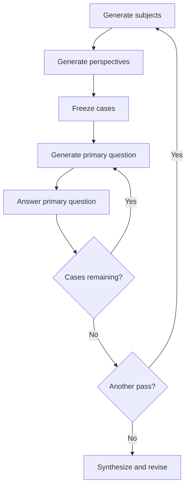

# Conversation

**You**

> [https://chatgpt.com/share/6afbf0a9-1d90-83e8-bd6c-edccecec1981](https://chatgpt.com/share/6afbf0a9-1d90-83e8-bd6c-edccecec1981)
> Use the terminal repo issue 3 and extractor to extract this file as your first attempt to read it

**Assistant · Commentary**

> I’ll inspect Terminals Issue #3 and locate the extractor before attempting to read the shared conversation.

**Assistant · Commentary**

> The extraction command is posted and GitHub identifies its author as the repository owner. The output directory has not appeared yet; I’m checking publication through GitHub without opening the shared URL directly.

**Assistant**

I submitted the extraction through [Terminals Issue #3](https://github.com/BestNameYet/Terminals/issues/3#issuecomment-6940393757), using the repository’s designated `chatgpt-shared-conversation-extractor.yml` workflow.

The requested export profile is `complete`, which includes the original HTML, structured conversation data, Markdown transcript, and verification records.

I have not accessed the shared conversation URL directly.

**Assistant · Commentary**

> Issue #3 successfully dispatched [extractor run 44029897416](https://github.com/BestNameYet/Terminals/actions/runs/44029897416). The export job is now running.

**Assistant**

I submitted the extraction through [Terminals Issue #3](https://github.com/BestNameYet/Terminals/issues/3#issuecomment-6940393757), using the repository’s designated `chatgpt-shared-conversation-extractor.yml` workflow.

The requested export profile is `complete`, which includes the original HTML, structured conversation data, Markdown transcript, and verification records.

I have not accessed the shared conversation URL directly.

<row align="center" gap={2}><icon name="check-circle-filled" color="success" size="lg"/><text weight="medium">Extraction and publication successful</text></row>

| Verification | Result |
|---|---:|
| Extraction attempts | 1 |
| HTTP response | 200 |
| Source-linear nodes | 1,427 |
| Selected visible messages | 661 |
| Published files | 8/8 |
| Remote readback verification | Passed |

**Extracted resources**

- [Complete output directory](https://github.com/BestNameYet/Terminals/tree/main/workspaces/shared-conversations/6afbf0a9-1d90-83e8-bd6c-edccecec1981/44029897416-1)
- [Markdown conversation](https://github.com/BestNameYet/Terminals/blob/main/workspaces/shared-conversations/6afbf0a9-1d90-83e8-bd6c-edccecec1981/44029897416-1/conversation.md)
- [Extractor workflow run](https://github.com/BestNameYet/Terminals/actions/runs/44029897416)

I retrieved the extracted Markdown transcript and confirmed that it covers the Codespace watchdog investigation and the development and deployment of the Q&A perspective cascade for both Procedure variants.

The first extraction attempt succeeded. No alternative extraction method was necessary. The transcript contains redacted plugin responses, and I have not yet analyzed every message.

**Assistant**

<row align="center" gap={2}><icon name="check-circle-filled" color="success" size="lg"/><text weight="medium">Extraction and publication successful</text></row>

| Verification | Result |
|---|---:|
| Extraction attempts | 1 |
| HTTP response | 200 |
| Source-linear nodes | 1,427 |
| Selected visible messages | 661 |
| Published files | 8/8 |
| Remote readback verification | Passed |

**Extracted resources**

- [Complete output directory](https://github.com/BestNameYet/Terminals/tree/main/workspaces/shared-conversations/6afbf0a9-1d90-83e8-bd6c-edccecec1981/44029897416-1)
- [Markdown conversation](https://github.com/BestNameYet/Terminals/blob/main/workspaces/shared-conversations/6afbf0a9-1d90-83e8-bd6c-edccecec1981/44029897416-1/conversation.md)
- [Extractor workflow run](https://github.com/BestNameYet/Terminals/actions/runs/44029897416)

I retrieved the extracted Markdown transcript and confirmed that it covers the Codespace watchdog investigation and the development and deployment of the Q&A perspective cascade for both Procedure variants.

The first extraction attempt succeeded. No alternative extraction method was necessary. The transcript contains redacted plugin responses, and I have not yet analyzed every message.

---

**You**

> using procedure and procedure -r, use the disucssion of interrogatories found in the extracted conversation, compile academic sources, and expand on the interrogation of the draft document discussed there.

**Assistant · Commentary**

> I’ll retrieve the interrogation discussion from the extracted transcript, then invoke both Procedure variants and use academic research to extend the draft’s methodology.

**Assistant · Commentary**

> Both runs accepted the verbatim request and reached `user_intent`. The literature points to a distinction worth developing: interrogating individual statements is different from interrogating the structure and completeness of the draft as a whole.

**Assistant**

# Interrogation of the draft: an expanded methodology

The discussion in the [extracted conversation](https://github.com/BestNameYet/Terminals/blob/main/workspaces/shared-conversations/6afbf0a9-1d90-83e8-bd6c-edccecec1981/44029897416-1/conversation.md#L1465-L1501) establishes two distinct forms of inquiry:

- **Task interrogation:** The agent generates questions whose answers help it understand and fulfill the request.
- **Draft interrogation:** The agent produces a provisional solution and interrogates the knowledge, decisions, assumptions, and relationships embodied in that solution.

The second form is particularly powerful as a design concept because a concrete solution creates new opportunities for inquiry that did not exist when the agent was examining only the original request.

The academic literature offers several formal approaches to exploiting this property. The closest matches are **inferential erotetic logic, perspective-based reading, argumentation theory, design space analysis, and question-based verification.**

## 1. The expanded inquiry surface

The current recursive Q&A mechanism can be extended beyond individual answers to interrogate an entire document at multiple levels.

<box border radius="lg" padding={3} gap={3}>
  <svg viewBox="0 0 340 285" width="100%">
    {#each [{x:10,y:6,w:320,h:48,c:"#64748b",t:"Document",s:"Purpose, completeness, global coherence"},{x:24,y:62,w:292,h:48,c:"#397ab5",t:"Sections",s:"Functions, organization, coverage"},{x:38,y:118,w:264,h:48,c:"#0d9488",t:"Semantic units",s:"Claims, decisions, requirements, actions"},{x:52,y:174,w:236,h:48,c:"#a16207",t:"Relationships",s:"Dependencies, conflicts, implications"},{x:66,y:230,w:208,h:48,c:"#8b5cf6",t:"Epistemic foundations",s:"Evidence, assumptions, warrants"}] as r}
      <rect x={r.x} y={r.y} width={r.w} height={r.h} rx="6" fill={r.c} fillOpacity=".10" stroke={r.c} strokeOpacity=".7"/>
      <text x="170" y={r.y+19} textAnchor="middle" fontSize="12" fontWeight="600" fill="currentColor">{r.t}</text>
      <text x="170" y={r.y+35} textAnchor="middle" fontSize="9.5" fill="currentColor">{r.s}</text>
    {/each}
  </svg>
  <caption>Each level is an independent subject of interrogation. Questions can also traverse between levels.</caption>
</box>

Interrogating every sentence is not equivalent to interrogating the entire document. An omitted requirement, an unconsidered alternative, or a contradiction between distant sections may escape a purely sentence-level inquiry.

The document itself must therefore be an independent subject of interrogation, alongside its constituent parts.

**Assistant · Commentary**

> The two procedures have produced separate initial Q&A sets. The original emphasizes interrogatory structure; the revised run emphasizes omissions, evidence quality, and source traceability.

**Assistant**

## 2. Academic foundations

### Formal theories of inquiry and document analysis

| Academic source | Application to Procedure |
|---|---|
| Hintikka (1999), *Inquiry as Inquiry: A Logic of Scientific Discovery* <Cite ref="turn607268search13"/> | Treat inquiry as a succession of questions whose answers enlarge the available knowledge. |
| Wiśniewski & Leszczyńska-Jasion (2015), *Inferential Erotetic Logic Meets Inquisitive Semantics* <Cite ref="turn190032search5"/> | Formal precedent for deriving new questions from existing questions and declarative statements. |
| Shull, Rus & Basili (2000), *How Perspective-Based Reading Can Improve Requirements Inspections* <Cite refs={["turn607268search0","turn607268search2"]}/> | Examine the same document from different perspectives using structured inspection procedures. |
| Tawfik et al. (2020), *Role of Questions in Inquiry-Based Instruction* <Cite ref="turn747653search0"/> | Classify questions by the kinds of knowledge they elicit, including causal, procedural, comparative and interpretive knowledge. |
| Toulmin's argumentation model and subsequent critical-question research <Cite refs={["turn167459search0","turn167459search2"]}/> | Identify claims, supporting grounds, implicit warrants, qualifications and rebuttals. |
| MacLean et al. (1991), *Questions, Options, and Criteria* <Cite ref="turn167459search1"/> | Expose the decision space surrounding a proposed solution, including discarded alternatives. |
| Graesser et al. (1996), *Question-Driven Explanatory Reasoning* <Cite ref="turn747653search17"/> | Elicit causal chains, logical justifications and goal–action hierarchies. |
| Van Lamsweerde & Letier (2000), *Handling Obstacles in Goal-Oriented Requirements Engineering* <Cite ref="turn747653search7"/> | Derive conditions that prevent a proposed solution from satisfying its objectives. |
| Gentner (1983), *Structure-Mapping: A Theoretical Framework for Analogy* <Cite ref="turn747653search3"/> | Discover relevant solutions and relationships through structural analogies with other domains. |
| Mitchell, Russo & Pennington (1989), *Back to the Future: Temporal Perspective in the Explanation of Events* <Cite ref="turn607268search1"/> | Generate possible explanations for hypothetical outcomes of a proposed solution. |

### Research specifically involving language models

| Academic source | Applicable mechanism |
|---|---|
| *The Art of Socratic Questioning* (EMNLP 2023) <Cite ref="turn747653search13"/> | Recursive generation and answering of subordinate questions. |
| *Self-Ask* (EMNLP 2023) <Cite ref="turn363929search17"/> | Decomposition into explicit follow-up questions, optionally answered using search. |
| *Self-Refine* (NeurIPS 2023) <Cite ref="turn363929search4"/> | Iteratively critiquing and revising generated material. |
| *FActScore* (EMNLP 2023) <Cite ref="turn363929search3"/> | Decomposition of documents into individually verifiable factual assertions. |
| *Chain-of-Verification* (ACL 2024) <Cite ref="turn363929search2"/> | Generation of verification questions from a draft, followed by independent answering. |
| *CRITIC* (ICLR 2024) <Cite ref="turn190032search1"/> | Supplement internal critique with external tool feedback. |
| *RARR* (ACL 2023) <Cite ref="turn190032search0"/> | Research and revise unsupported content while preserving supported material. |
| *QuestEval* (EMNLP 2021) <Cite ref="turn887327search1"/> | Question-based assessment of factual consistency and information coverage. |
| *Lost in the Middle* (TACL 2024) <Cite ref="turn363929search0"/> | Demonstrates why relevant context should be deliberately selected and presented, rather than merely accumulated. |

Two publications are particularly close to your original discovery.

**Inferential erotetic logic** formalizes how propositions can evoke questions and how existing questions, combined with declarative information, can give rise to further questions. This is a theoretical counterpart to your recursive Q&A operators.

**Perspective-based reading** provides a software-engineering precedent for systematically examining the same document from different analytical perspectives. This corresponds directly to your concept of orthogonal interrogation.

Neither establishes that your specific combination is optimal for agents. They do, however, provide substantial foundations from which to develop it.

**Assistant · Commentary**

> Both live runs accepted the first two derivative Q&A cases—assumptions and evidence—and advanced to alternatives. The strongest additions emerging from those cases are an independent requirements-to-draft pass and typed document units, rather than treating every sentence as a factual claim.

**Assistant**

## 3. An important expansion: interrogate in both directions

There are two fundamentally different ways to question a draft.

<box border radius="lg" padding={3} gap={2}>
  <svg viewBox="0 0 340 220" width="100%">
    <rect x="89" y="8" width="162" height="45" rx="7" fill="#64748b" fillOpacity=".12" stroke="#64748b"/>
    <text x="170" y="27" textAnchor="middle" fontWeight="600" fontSize="12" fill="currentColor">Original request</text>
    <text x="170" y="41" textAnchor="middle" fontSize="10" fill="currentColor">Constraints and evidence</text>
    <rect x="89" y="165" width="162" height="45" rx="7" fill="#64748b" fillOpacity=".12" stroke="#64748b"/>
    <text x="170" y="184" textAnchor="middle" fontWeight="600" fontSize="12" fill="currentColor">Draft document</text>
    <text x="170" y="198" textAnchor="middle" fontSize="10" fill="currentColor">Claims and decisions</text>
    <path d="M 132 55 L 132 159" stroke="#0d9488" strokeWidth="2" fill="none"/>
    <path d="M 126 151 L 132 160 L 138 151" stroke="#0d9488" strokeWidth="2" fill="none"/>
    <path d="M 208 161 L 208 59" stroke="#397ab5" strokeWidth="2" fill="none"/>
    <path d="M 202 67 L 208 58 L 214 67" stroke="#397ab5" strokeWidth="2" fill="none"/>
    <text x="117" y="93" textAnchor="end" fontSize="11" fontWeight="600" fill="#0d9488">Coverage</text>
    <text x="117" y="109" textAnchor="end" fontSize="10" fill="currentColor">What did the</text>
    <text x="117" y="122" textAnchor="end" fontSize="10" fill="currentColor">draft omit?</text>
    <text x="222" y="93" fontSize="11" fontWeight="600" fill="#397ab5">Validity</text>
    <text x="222" y="109" fontSize="10" fill="currentColor">What supports</text>
    <text x="222" y="122" fontSize="10" fill="currentColor">the draft?</text>
  </svg>
</box>

**Draft-derived questions** expose unsupported claims, questionable decisions, ambiguities and hidden assumptions.

**Request-derived questions** expose omissions. The agent generates questions from the original task, without relying on what the draft happens to contain, and then examines whether the document answers them.

The distinction has a precedent in question-based summarization evaluation, particularly QuestEval. <Cite ref="turn887327search1"/>

I would also introduce a third operation: **reconstructing the implicit questions answered by the draft**. Research into Questions Under Discussion (QUD) examines how statements in a document relate to explicit or implicit questions. <Cite refs={["turn190032search12","turn190032search13"]}/>

For example, a proposed design contains the statement:

> All procedure runs must employ a mandatory scratchpad.

Reconstructing its implicit questions produces:

- How should analytical findings persist across state transitions?
- Should recording those findings be discretionary?
- What should prevent advancement when relevant findings have not been recorded?

These questions expose the underlying design decisions represented by a single sentence. They also provide new subjects for recursive inquiry.

## 4. A library of generic interrogatory operators

Rather than hard-coding task-specific questions, Procedure should maintain a library of higher-order instructions that cause the agent to construct them.

| Operator | Generic question-generation instruction |
|---|---|
| Decomposition | What distinct propositions, decisions or commitments are contained in this passage? |
| Explication | What knowledge must someone possess to understand this passage fully? |
| Presupposition | What must already be true for this statement or decision to make sense? |
| Justification | What supports the conclusion, and what connects that support to the conclusion? |
| Causation | What mechanism produces the stated result? |
| Implication | If this statement is true, what else follows that the document has not expressed? |
| Counterexample | Under what circumstances would this statement cease to hold? |
| Counterfactual | What would change if a significant premise were reversed or removed? |
| Alternatives | What other approach could fulfill the same purpose? |
| Discrimination | What evidence would distinguish the competing explanations or alternatives? |
| Necessity | What would be lost if this element were removed? |
| Sufficiency | What additional conditions are necessary for this element to fulfill its purpose? |
| Composition | What becomes apparent when these independently stated elements are considered together? |
| Completeness | What relevant knowledge is absent from the document? |
| Operationalization | How could this abstract statement be converted into a concrete action or observable condition? |
| Analogy | What structurally similar problem in another discipline could illuminate this one? |
| Enhancement | What additional capabilities or opportunities does this proposal make possible? |
| Verification | What observation would establish, qualify or overturn this statement? |
| Metainterrogation | What line of inquiry has the preceding interrogation failed to pursue? |

These operators deliberately include **constructive and generative inquiry**, not merely criticism. The objective is knowledge discovery, and a draft can contain unrealized opportunities as readily as deficiencies.

The research taxonomy of Tawfik et al. and the explanatory inquiry work of Graesser provide foundations for distinguishing such operations by their epistemic function. <Cite refs={["turn747653search0","turn747653search17"]}/>

**Assistant · Commentary**

> Both runs have completed ten of their fifteen first-round derivative cases. The research supports separating the reader’s perspective from the intellectual operation it applies—for example, a tester can use both counterexample and causation operators. That distinction will be central to the proposed extension.

**Assistant**

# Interrogation of the draft: an expanded methodology

The discussion in the [extracted conversation](https://github.com/BestNameYet/Terminals/blob/main/workspaces/shared-conversations/6afbf0a9-1d90-83e8-bd6c-edccecec1981/44029897416-1/conversation.md#L1465-L1501) establishes two distinct forms of inquiry:

- **Task interrogation:** The agent generates questions whose answers help it understand and fulfill the request.
- **Draft interrogation:** The agent produces a provisional solution and interrogates the knowledge, decisions, assumptions, and relationships embodied in that solution.

The second form is particularly powerful as a design concept because a concrete solution creates new opportunities for inquiry that did not exist when the agent was examining only the original request.

The academic literature offers several formal approaches to exploiting this property. The closest matches are **inferential erotetic logic, perspective-based reading, argumentation theory, design space analysis, and question-based verification.**

## 1. The expanded inquiry surface

The current recursive Q&A mechanism can be extended beyond individual answers to interrogate an entire document at multiple levels.

<box border radius="lg" padding={3} gap={3}>
  <svg viewBox="0 0 340 285" width="100%">
    {#each [{x:10,y:6,w:320,h:48,c:"#64748b",t:"Document",s:"Purpose, completeness, global coherence"},{x:24,y:62,w:292,h:48,c:"#397ab5",t:"Sections",s:"Functions, organization, coverage"},{x:38,y:118,w:264,h:48,c:"#0d9488",t:"Semantic units",s:"Claims, decisions, requirements, actions"},{x:52,y:174,w:236,h:48,c:"#a16207",t:"Relationships",s:"Dependencies, conflicts, implications"},{x:66,y:230,w:208,h:48,c:"#8b5cf6",t:"Epistemic foundations",s:"Evidence, assumptions, warrants"}] as r}
      <rect x={r.x} y={r.y} width={r.w} height={r.h} rx="6" fill={r.c} fillOpacity=".10" stroke={r.c} strokeOpacity=".7"/>
      <text x="170" y={r.y+19} textAnchor="middle" fontSize="12" fontWeight="600" fill="currentColor">{r.t}</text>
      <text x="170" y={r.y+35} textAnchor="middle" fontSize="9.5" fill="currentColor">{r.s}</text>
    {/each}
  </svg>
  <caption>Each level is an independent subject of interrogation. Questions can also traverse between levels.</caption>
</box>

Interrogating every sentence is not equivalent to interrogating the entire document. An omitted requirement, an unconsidered alternative, or a contradiction between distant sections may escape a purely sentence-level inquiry.

The document itself must therefore be an independent subject of interrogation, alongside its constituent parts.

## 2. Academic foundations

### Formal theories of inquiry and document analysis

| Academic source | Application to Procedure |
|---|---|
| Hintikka (1999), *Inquiry as Inquiry: A Logic of Scientific Discovery* <Cite ref="turn607268search13"/> | Treat inquiry as a succession of questions whose answers enlarge the available knowledge. |
| Wiśniewski & Leszczyńska-Jasion (2015), *Inferential Erotetic Logic Meets Inquisitive Semantics* <Cite ref="turn190032search5"/> | Formal precedent for deriving new questions from existing questions and declarative statements. |
| Shull, Rus & Basili (2000), *How Perspective-Based Reading Can Improve Requirements Inspections* <Cite refs={["turn607268search0","turn607268search2"]}/> | Examine the same document from different perspectives using structured inspection procedures. |
| Tawfik et al. (2020), *Role of Questions in Inquiry-Based Instruction* <Cite ref="turn747653search0"/> | Classify questions by the kinds of knowledge they elicit, including causal, procedural, comparative and interpretive knowledge. |
| Toulmin's argumentation model and subsequent critical-question research <Cite refs={["turn167459search0","turn167459search2"]}/> | Identify claims, supporting grounds, implicit warrants, qualifications and rebuttals. |
| MacLean et al. (1991), *Questions, Options, and Criteria* <Cite ref="turn167459search1"/> | Expose the decision space surrounding a proposed solution, including discarded alternatives. |
| Graesser et al. (1996), *Question-Driven Explanatory Reasoning* <Cite ref="turn747653search17"/> | Elicit causal chains, logical justifications and goal–action hierarchies. |
| Van Lamsweerde & Letier (2000), *Handling Obstacles in Goal-Oriented Requirements Engineering* <Cite ref="turn747653search7"/> | Derive conditions that prevent a proposed solution from satisfying its objectives. |
| Gentner (1983), *Structure-Mapping: A Theoretical Framework for Analogy* <Cite ref="turn747653search3"/> | Discover relevant solutions and relationships through structural analogies with other domains. |
| Mitchell, Russo & Pennington (1989), *Back to the Future: Temporal Perspective in the Explanation of Events* <Cite ref="turn607268search1"/> | Generate possible explanations for hypothetical outcomes of a proposed solution. |

### Research specifically involving language models

| Academic source | Applicable mechanism |
|---|---|
| *The Art of Socratic Questioning* (EMNLP 2023) <Cite ref="turn747653search13"/> | Recursive generation and answering of subordinate questions. |
| *Self-Ask* (EMNLP 2023) <Cite ref="turn363929search17"/> | Decomposition into explicit follow-up questions, optionally answered using search. |
| *Self-Refine* (NeurIPS 2023) <Cite ref="turn363929search4"/> | Iteratively critiquing and revising generated material. |
| *FActScore* (EMNLP 2023) <Cite ref="turn363929search3"/> | Decomposition of documents into individually verifiable factual assertions. |
| *Chain-of-Verification* (ACL 2024) <Cite ref="turn363929search2"/> | Generation of verification questions from a draft, followed by independent answering. |
| *CRITIC* (ICLR 2024) <Cite ref="turn190032search1"/> | Supplement internal critique with external tool feedback. |
| *RARR* (ACL 2023) <Cite ref="turn190032search0"/> | Research and revise unsupported content while preserving supported material. |
| *QuestEval* (EMNLP 2021) <Cite ref="turn887327search1"/> | Question-based assessment of factual consistency and information coverage. |
| *Lost in the Middle* (TACL 2024) <Cite ref="turn363929search0"/> | Demonstrates why relevant context should be deliberately selected and presented, rather than merely accumulated. |

Two publications are particularly close to your original discovery.

**Inferential erotetic logic** formalizes how propositions can evoke questions and how existing questions, combined with declarative information, can give rise to further questions. This is a theoretical counterpart to your recursive Q&A operators.

**Perspective-based reading** provides a software-engineering precedent for systematically examining the same document from different analytical perspectives. This corresponds directly to your concept of orthogonal interrogation.

Neither establishes that your specific combination is optimal for agents. They do, however, provide substantial foundations from which to develop it.

## 3. An important expansion: interrogate in both directions

There are two fundamentally different ways to question a draft.

<box border radius="lg" padding={3} gap={2}>
  <svg viewBox="0 0 340 220" width="100%">
    <rect x="89" y="8" width="162" height="45" rx="7" fill="#64748b" fillOpacity=".12" stroke="#64748b"/>
    <text x="170" y="27" textAnchor="middle" fontWeight="600" fontSize="12" fill="currentColor">Original request</text>
    <text x="170" y="41" textAnchor="middle" fontSize="10" fill="currentColor">Constraints and evidence</text>
    <rect x="89" y="165" width="162" height="45" rx="7" fill="#64748b" fillOpacity=".12" stroke="#64748b"/>
    <text x="170" y="184" textAnchor="middle" fontWeight="600" fontSize="12" fill="currentColor">Draft document</text>
    <text x="170" y="198" textAnchor="middle" fontSize="10" fill="currentColor">Claims and decisions</text>
    <path d="M 132 55 L 132 159" stroke="#0d9488" strokeWidth="2" fill="none"/>
    <path d="M 126 151 L 132 160 L 138 151" stroke="#0d9488" strokeWidth="2" fill="none"/>
    <path d="M 208 161 L 208 59" stroke="#397ab5" strokeWidth="2" fill="none"/>
    <path d="M 202 67 L 208 58 L 214 67" stroke="#397ab5" strokeWidth="2" fill="none"/>
    <text x="117" y="93" textAnchor="end" fontSize="11" fontWeight="600" fill="#0d9488">Coverage</text>
    <text x="117" y="109" textAnchor="end" fontSize="10" fill="currentColor">What did the</text>
    <text x="117" y="122" textAnchor="end" fontSize="10" fill="currentColor">draft omit?</text>
    <text x="222" y="93" fontSize="11" fontWeight="600" fill="#397ab5">Validity</text>
    <text x="222" y="109" fontSize="10" fill="currentColor">What supports</text>
    <text x="222" y="122" fontSize="10" fill="currentColor">the draft?</text>
  </svg>
</box>

**Draft-derived questions** expose unsupported claims, questionable decisions, ambiguities and hidden assumptions.

**Request-derived questions** expose omissions. The agent generates questions from the original task, without relying on what the draft happens to contain, and then examines whether the document answers them.

The distinction has a precedent in question-based summarization evaluation, particularly QuestEval. <Cite ref="turn887327search1"/>

I would also introduce a third operation: **reconstructing the implicit questions answered by the draft**. Research into Questions Under Discussion (QUD) examines how statements in a document relate to explicit or implicit questions. <Cite refs={["turn190032search12","turn190032search13"]}/>

For example, a proposed design contains the statement:

> All procedure runs must employ a mandatory scratchpad.

Reconstructing its implicit questions produces:

- How should analytical findings persist across state transitions?
- Should recording those findings be discretionary?
- What should prevent advancement when relevant findings have not been recorded?

These questions expose the underlying design decisions represented by a single sentence. They also provide new subjects for recursive inquiry.

## 4. A library of generic interrogatory operators

Rather than hard-coding task-specific questions, Procedure should maintain a library of higher-order instructions that cause the agent to construct them.

| Operator | Generic question-generation instruction |
|---|---|
| Decomposition | What distinct propositions, decisions or commitments are contained in this passage? |
| Explication | What knowledge must someone possess to understand this passage fully? |
| Presupposition | What must already be true for this statement or decision to make sense? |
| Justification | What supports the conclusion, and what connects that support to the conclusion? |
| Causation | What mechanism produces the stated result? |
| Implication | If this statement is true, what else follows that the document has not expressed? |
| Counterexample | Under what circumstances would this statement cease to hold? |
| Counterfactual | What would change if a significant premise were reversed or removed? |
| Alternatives | What other approach could fulfill the same purpose? |
| Discrimination | What evidence would distinguish the competing explanations or alternatives? |
| Necessity | What would be lost if this element were removed? |
| Sufficiency | What additional conditions are necessary for this element to fulfill its purpose? |
| Composition | What becomes apparent when these independently stated elements are considered together? |
| Completeness | What relevant knowledge is absent from the document? |
| Operationalization | How could this abstract statement be converted into a concrete action or observable condition? |
| Analogy | What structurally similar problem in another discipline could illuminate this one? |
| Enhancement | What additional capabilities or opportunities does this proposal make possible? |
| Verification | What observation would establish, qualify or overturn this statement? |
| Metainterrogation | What line of inquiry has the preceding interrogation failed to pursue? |

These operators deliberately include **constructive and generative inquiry**, not merely criticism. The objective is knowledge discovery, and a draft can contain unrealized opportunities as readily as deficiencies.

The research taxonomy of Tawfik et al. and the explanatory inquiry work of Graesser provide foundations for distinguishing such operations by their epistemic function. <Cite refs={["turn747653search0","turn747653search17"]}/>

## 5. Separate the subject, perspective and operator

An important architectural improvement is to distinguish three independent dimensions of an interrogatory.

<box border radius="lg" padding={3} gap={3}>
  <grid columns={3} gap={2}>
    <grid-item>
      <box background="surface-secondary" radius="md" padding={2} gap={1}>
        **Subject**
        <caption>What is being examined?</caption>
        <divider/>
        <text size="sm">Document</text>
        <text size="sm">Section</text>
        <text size="sm">Decision</text>
        <text size="sm">Q&A pair</text>
        <text size="sm">Relationship</text>
      </box>
    </grid-item>
    <grid-item>
      <box background="surface-secondary" radius="md" padding={2} gap={1}>
        **Perspective**
        <caption>From what viewpoint?</caption>
        <divider/>
        <text size="sm">Designer</text>
        <text size="sm">Operator</text>
        <text size="sm">Tester</text>
        <text size="sm">Maintainer</text>
        <text size="sm">Domain expert</text>
      </box>
    </grid-item>
    <grid-item>
      <box background="surface-secondary" radius="md" padding={2} gap={1}>
        **Operator**
        <caption>What intellectual operation?</caption>
        <divider/>
        <text size="sm">Decompose</text>
        <text size="sm">Challenge</text>
        <text size="sm">Compare</text>
        <text size="sm">Infer</text>
        <text size="sm">Verify</text>
      </box>
    </grid-item>
  </grid>
  <svg viewBox="0 0 320 95" width="100%">
    {#each [52,160,268] as x}
      <path d={`M ${x} 0 L ${x} 14 L 160 34`} fill="none" stroke="currentColor" strokeOpacity=".4" strokeWidth="1.5"/>
    {/each}
    <rect x="52" y="34" width="216" height="48" rx="7" fill="#0d9488" fillOpacity=".10" stroke="#0d9488"/>
    <text x="160" y="54" textAnchor="middle" fontWeight="600" fontSize="12" fill="currentColor">Agent-generated primary question</text>
    <text x="160" y="69" textAnchor="middle" fontSize="10" fill="currentColor">Specific to the assigned combination</text>
  </svg>
</box>

For example, the tester perspective could apply the counterexample operator to a particular requirement. The designer perspective could apply the same operator to the same requirement and produce a substantially different question.

There is an analogous technique in chemical engineering: **Hazard and Operability Analysis (HAZOP)**. HAZOP systematically combines guide words with properties of a system to generate deviations for examination. <Cite ref="turn747653search11"/>

Procedure could adopt that combinatorial principle without restricting inquiry to failure analysis.

## 6. The proposed draft interrogatory sequence

<box border radius="lg" padding={3} gap={1}>
  {#each [{n:"01",t:"Generate provisional draft",s:"Produce a complete first attempt from the request and existing Q&A."},{n:"02",t:"Decompose the draft",s:"Identify claims, decisions, requirements, actions and relationships."},{n:"03",t:"Discover inquiry perspectives",s:"Generate relevant viewpoints for the document and its constituent elements."},{n:"04",t:"Generate interrogatory cases",s:"Apply generic operators to the selected subjects and perspectives."},{n:"05",t:"Answer primary questions",s:"Present each saved question with its corresponding source material."},{n:"06",t:"Recursively interrogate the answers",s:"Apply the existing Q&A cascade to the newly generated knowledge."},{n:"07",t:"Reconcile findings",s:"Resolve contradictions, preserve alternatives and establish revision requirements."},{n:"08",t:"Generate revised draft",s:"Revise the document using the accumulated inquiry."},{n:"09",t:"Interrogate the revision",s:"Examine changes, their consequences and newly introduced assumptions."}] as step,i}
    <row align="start" gap={3}>
      <box background="surface-secondary" radius="md" size="36px" align="center" justify="center"><text weight="medium" tabularNums={true}>{step.n}</text></box>
      <box flex={1} gap=1>
        **{step.t}**
        <caption>{step.s}</caption>
      </box>
    </row>
    {#if i!==8}<box padding={{left:4}}><icon name="arrow-down" color="secondary" size="sm"/></box>{/if}
  {/each}
</box>

The present Q&A cascade becomes a reusable subprocedure within a larger document-oriented inquiry.

### Proposed generic prompts

| State | Instruction |
|---|---|
| Draft generation | Given the request and the accumulated knowledge, produce a provisional solution. |
| Subject generation | Identify the elements of this document that could constitute independent subjects of inquiry. |
| Perspective generation | From what perspectives could this subject be examined to expose additional useful knowledge? |
| Primary question generation | Examine the subject from the assigned perspective using the assigned interrogatory operator. Generate the primary question. |
| Primary question answering | Answer the primary question using the supplied source material and any additional evidence necessary. |
| Synthesis | What knowledge has emerged from considering these exchanges collectively that was not expressed in any individual exchange? |
| Revision | Reconstruct the draft in light of the accumulated findings. |
| Revision interrogation | What new questions arise specifically because of the changes made to the document? |

## 7. Example: interrogating Procedure's own draft design

Consider this statement from the design discussed in the extracted conversation:

> Every generated case receives exactly one answer before Procedure advances to the next sequence.

The following interrogations illustrate how much additional knowledge a single design decision can expose.

| Operator | Agent-generated question | Knowledge exposed |
|---|---|---|
| Assumption | What constitutes an answer when the required evidence cannot be obtained? | Answer completion and problem resolution are different states. |
| Decomposition | Does this requirement govern answer submission, acceptance, persistence or all three? | Separate execution invariants. |
| Counterexample | What happens when an answer is persisted but the response acknowledging it is lost? | Replay and idempotency requirements. |
| Composition | How does the fixed case array interact with perspectives discovered during answering? | A boundary between current-round and subsequent-round generation. |
| Necessity | Why must every case receive a return? | Deterministic coverage and distinguishable unresolved outcomes. |
| Enhancement | What additional uses could be made of the resulting case history? | Reusable task knowledge, design rationale and regression-test candidates. |

Each row produces a new Q&A pair eligible for further interrogation.

The document is no longer simply an answer. It becomes a **generator of additional inquiry subjects**.

## 8. Deterministic representation

I would preserve the existing case execution mechanism and generalize the kinds of source material a case can reference.

```json
{
  "case_id": "D0.R1.C4",
  "subject_ids": ["D0.U12", "D0.U18"],
  "perspective": "state_machine_design",
  "operator": "composition",
  "primary_question": "How do these two requirements interact?",
  "answer_mode": "contextual"
}
```

A subject could be a document passage, requirement, previous Q&A pair, diagram element, decision, evidence item or relationship.

The result is more expressive than a strictly recursive tree because questions can arise from several independently established subjects.

## 9. Controlling the intensity of interrogation

{@body const [subjects,setSubjects]=DIL.useState(8)}
{@body const [perspectives,setPerspectives]=DIL.useState(4)}
{@body const [operators,setOperators]=DIL.useState(3)}
{@body const [depth,setDepth]=DIL.useState(1)}
{@body const total=Array.from({length:depth},(_,i)=>subjects*Math.pow(perspectives*operators,i+1)).reduce((a,b)=>a+b,0)}
<card gap={3}>
  <title size="md">Interrogatory intensity model</title>
  <row><label>Document subjects</label><spacer/><title size="sm" tabularNums={true}>{subjects}</title></row>
  <slider min={1} max={30} value={subjects} onChange={setSubjects}/>
  <row><label>Perspectives per subject</label><spacer/><title size="sm" tabularNums={true}>{perspectives}</title></row>
  <slider min={1} max={10} value={perspectives} onChange={setPerspectives}/>
  <row><label>Operators per perspective</label><spacer/><title size="sm" tabularNums={true}>{operators}</title></row>
  <slider min={1} max={10} value={operators} onChange={setOperators}/>
  <row><label>Interrogation rounds</label><spacer/><title size="sm" tabularNums={true}>{depth}</title></row>
  <slider min={1} max={4} value={depth} onChange={setDepth}/>
  <divider/>
  <caption>Total generated Q&A pairs</caption>
  <title size="2xl" tabularNums={true}>{total.toLocaleString("en-US")}</title>
  {#each Array.from({length:depth},(_,i)=>subjects*Math.pow(perspectives*operators,i+1)) as count,i}
    <row align="center">
      <text size="sm" width="64px">Round {i+1}</text>
      <box flex={1}><box height={20} radius="sm" background="#0d9488" width={`${Math.max(1,count/(subjects*Math.pow(perspectives*operators,depth))*100)}%`}/></box>
      <text size="sm" tabularNums={true}>{count.toLocaleString("en-US")}</text>
    </row>
  {/each}
  <caption>Assumes exhaustive combinations, one question per case, and every generated pair becoming the subject of the next round.</caption>
</card>

This provides independent controls over breadth, diversity and recursion without requiring the agent to decide prematurely that sufficient analysis has occurred.

## 10. Principal conclusions

The most promising expansion is to move beyond the idea of a question cascade as merely a recursive Q&A mechanism and introduce **systematic transformations of the draft into new subjects of inquiry**.

Those transformations can expose knowledge that is:

- Explicitly expressed.
- Implicitly assumed.
- Logically entailed.
- Entirely absent.
- Distributed across several statements.
- Discoverable through alternative representations.
- Made possible by the proposed solution.

There is considerable academic support for the constituent techniques. There is also evidence against relying exclusively on unaided model self-correction. <Cite refs={["turn887327search0","turn167459search4"]}/> Consequently, the interrogation should generate and investigate findings without automatically treating every criticism as a valid correction.

---

## Procedure execution record

Both live procedures completed their initial Q&A and first derivative round, with three additional perspectives nominated in each run.

| Operation | Procedure | Procedure -r |
|---|---:|---:|
| Initial Q&A pairs | 3 | 3 |
| First-round derivative pairs | 15 | 15 |
| Total completed pairs | 18 | 18 |
| Second-round entry reached | Yes | Yes |
| Terminal completion | Pending | Pending |

<caption>Procedure nonce</caption>
<text size="sm" preserveWhitespace={true}>722e0dc6-4b01-4446-806e-97593f460497</text>
<caption>Procedure -r nonce</caption>
<text size="sm" preserveWhitespace={true}>ebb50c75-403d-41b0-9367-931c4db6bf19</text>

I completed the research synthesis using the accepted inquiry results, but did not exhaust the second derivative round, which would require at least another 60 Q&A pairs per run. I also corrected an initial scratchpad schema rejection. No Procedure implementation files were modified, and the expanded methodology remains a design proposal rather than an empirically validated system.

**Assistant**

## 5. Separate the subject, perspective and operator

An important architectural improvement is to distinguish three independent dimensions of an interrogatory.

<box border radius="lg" padding={3} gap={3}>
  <grid columns={3} gap={2}>
    <grid-item>
      <box background="surface-secondary" radius="md" padding={2} gap={1}>
        **Subject**
        <caption>What is being examined?</caption>
        <divider/>
        <text size="sm">Document</text>
        <text size="sm">Section</text>
        <text size="sm">Decision</text>
        <text size="sm">Q&A pair</text>
        <text size="sm">Relationship</text>
      </box>
    </grid-item>
    <grid-item>
      <box background="surface-secondary" radius="md" padding={2} gap={1}>
        **Perspective**
        <caption>From what viewpoint?</caption>
        <divider/>
        <text size="sm">Designer</text>
        <text size="sm">Operator</text>
        <text size="sm">Tester</text>
        <text size="sm">Maintainer</text>
        <text size="sm">Domain expert</text>
      </box>
    </grid-item>
    <grid-item>
      <box background="surface-secondary" radius="md" padding={2} gap={1}>
        **Operator**
        <caption>What intellectual operation?</caption>
        <divider/>
        <text size="sm">Decompose</text>
        <text size="sm">Challenge</text>
        <text size="sm">Compare</text>
        <text size="sm">Infer</text>
        <text size="sm">Verify</text>
      </box>
    </grid-item>
  </grid>
  <svg viewBox="0 0 320 95" width="100%">
    {#each [52,160,268] as x}
      <path d={`M ${x} 0 L ${x} 14 L 160 34`} fill="none" stroke="currentColor" strokeOpacity=".4" strokeWidth="1.5"/>
    {/each}
    <rect x="52" y="34" width="216" height="48" rx="7" fill="#0d9488" fillOpacity=".10" stroke="#0d9488"/>
    <text x="160" y="54" textAnchor="middle" fontWeight="600" fontSize="12" fill="currentColor">Agent-generated primary question</text>
    <text x="160" y="69" textAnchor="middle" fontSize="10" fill="currentColor">Specific to the assigned combination</text>
  </svg>
</box>

For example, the tester perspective could apply the counterexample operator to a particular requirement. The designer perspective could apply the same operator to the same requirement and produce a substantially different question.

There is an analogous technique in chemical engineering: **Hazard and Operability Analysis (HAZOP)**. HAZOP systematically combines guide words with properties of a system to generate deviations for examination. <Cite ref="turn747653search11"/>

Procedure could adopt that combinatorial principle without restricting inquiry to failure analysis.

## 6. The proposed draft interrogatory sequence

<box border radius="lg" padding={3} gap={1}>
  {#each [{n:"01",t:"Generate provisional draft",s:"Produce a complete first attempt from the request and existing Q&A."},{n:"02",t:"Decompose the draft",s:"Identify claims, decisions, requirements, actions and relationships."},{n:"03",t:"Discover inquiry perspectives",s:"Generate relevant viewpoints for the document and its constituent elements."},{n:"04",t:"Generate interrogatory cases",s:"Apply generic operators to the selected subjects and perspectives."},{n:"05",t:"Answer primary questions",s:"Present each saved question with its corresponding source material."},{n:"06",t:"Recursively interrogate the answers",s:"Apply the existing Q&A cascade to the newly generated knowledge."},{n:"07",t:"Reconcile findings",s:"Resolve contradictions, preserve alternatives and establish revision requirements."},{n:"08",t:"Generate revised draft",s:"Revise the document using the accumulated inquiry."},{n:"09",t:"Interrogate the revision",s:"Examine changes, their consequences and newly introduced assumptions."}] as step,i}
    <row align="start" gap={3}>
      <box background="surface-secondary" radius="md" size="36px" align="center" justify="center"><text weight="medium" tabularNums={true}>{step.n}</text></box>
      <box flex={1} gap=1>
        **{step.t}**
        <caption>{step.s}</caption>
      </box>
    </row>
    {#if i!==8}<box padding={{left:4}}><icon name="arrow-down" color="secondary" size="sm"/></box>{/if}
  {/each}
</box>

The present Q&A cascade becomes a reusable subprocedure within a larger document-oriented inquiry.

### Proposed generic prompts

| State | Instruction |
|---|---|
| Draft generation | Given the request and the accumulated knowledge, produce a provisional solution. |
| Subject generation | Identify the elements of this document that could constitute independent subjects of inquiry. |
| Perspective generation | From what perspectives could this subject be examined to expose additional useful knowledge? |
| Primary question generation | Examine the subject from the assigned perspective using the assigned interrogatory operator. Generate the primary question. |
| Primary question answering | Answer the primary question using the supplied source material and any additional evidence necessary. |
| Synthesis | What knowledge has emerged from considering these exchanges collectively that was not expressed in any individual exchange? |
| Revision | Reconstruct the draft in light of the accumulated findings. |
| Revision interrogation | What new questions arise specifically because of the changes made to the document? |

## 7. Example: interrogating Procedure's own draft design

Consider this statement from the design discussed in the extracted conversation:

> Every generated case receives exactly one answer before Procedure advances to the next sequence.

The following interrogations illustrate how much additional knowledge a single design decision can expose.

| Operator | Agent-generated question | Knowledge exposed |
|---|---|---|
| Assumption | What constitutes an answer when the required evidence cannot be obtained? | Answer completion and problem resolution are different states. |
| Decomposition | Does this requirement govern answer submission, acceptance, persistence or all three? | Separate execution invariants. |
| Counterexample | What happens when an answer is persisted but the response acknowledging it is lost? | Replay and idempotency requirements. |
| Composition | How does the fixed case array interact with perspectives discovered during answering? | A boundary between current-round and subsequent-round generation. |
| Necessity | Why must every case receive a return? | Deterministic coverage and distinguishable unresolved outcomes. |
| Enhancement | What additional uses could be made of the resulting case history? | Reusable task knowledge, design rationale and regression-test candidates. |

Each row produces a new Q&A pair eligible for further interrogation.

The document is no longer simply an answer. It becomes a **generator of additional inquiry subjects**.

## 8. Deterministic representation

I would preserve the existing case execution mechanism and generalize the kinds of source material a case can reference.

```json
{
  "case_id": "D0.R1.C4",
  "subject_ids": ["D0.U12", "D0.U18"],
  "perspective": "state_machine_design",
  "operator": "composition",
  "primary_question": "How do these two requirements interact?",
  "answer_mode": "contextual"
}
```

A subject could be a document passage, requirement, previous Q&A pair, diagram element, decision, evidence item or relationship.

The result is more expressive than a strictly recursive tree because questions can arise from several independently established subjects.

## 9. Controlling the intensity of interrogation

{@body const [subjects,setSubjects]=DIL.useState(8)}
{@body const [perspectives,setPerspectives]=DIL.useState(4)}
{@body const [operators,setOperators]=DIL.useState(3)}
{@body const [depth,setDepth]=DIL.useState(1)}
{@body const total=Array.from({length:depth},(_,i)=>subjects*Math.pow(perspectives*operators,i+1)).reduce((a,b)=>a+b,0)}
<card gap={3}>
  <title size="md">Interrogatory intensity model</title>
  <row><label>Document subjects</label><spacer/><title size="sm" tabularNums={true}>{subjects}</title></row>
  <slider min={1} max={30} value={subjects} onChange={setSubjects}/>
  <row><label>Perspectives per subject</label><spacer/><title size="sm" tabularNums={true}>{perspectives}</title></row>
  <slider min={1} max={10} value={perspectives} onChange={setPerspectives}/>
  <row><label>Operators per perspective</label><spacer/><title size="sm" tabularNums={true}>{operators}</title></row>
  <slider min={1} max={10} value={operators} onChange={setOperators}/>
  <row><label>Interrogation rounds</label><spacer/><title size="sm" tabularNums={true}>{depth}</title></row>
  <slider min={1} max={4} value={depth} onChange={setDepth}/>
  <divider/>
  <caption>Total generated Q&A pairs</caption>
  <title size="2xl" tabularNums={true}>{total.toLocaleString("en-US")}</title>
  {#each Array.from({length:depth},(_,i)=>subjects*Math.pow(perspectives*operators,i+1)) as count,i}
    <row align="center">
      <text size="sm" width="64px">Round {i+1}</text>
      <box flex={1}><box height={20} radius="sm" background="#0d9488" width={`${Math.max(1,count/(subjects*Math.pow(perspectives*operators,depth))*100)}%`}/></box>
      <text size="sm" tabularNums={true}>{count.toLocaleString("en-US")}</text>
    </row>
  {/each}
  <caption>Assumes exhaustive combinations, one question per case, and every generated pair becoming the subject of the next round.</caption>
</card>

This provides independent controls over breadth, diversity and recursion without requiring the agent to decide prematurely that sufficient analysis has occurred.

## 10. Principal conclusions

The most promising expansion is to move beyond the idea of a question cascade as merely a recursive Q&A mechanism and introduce **systematic transformations of the draft into new subjects of inquiry**.

Those transformations can expose knowledge that is:

- Explicitly expressed.
- Implicitly assumed.
- Logically entailed.
- Entirely absent.
- Distributed across several statements.
- Discoverable through alternative representations.
- Made possible by the proposed solution.

There is considerable academic support for the constituent techniques. There is also evidence against relying exclusively on unaided model self-correction. <Cite refs={["turn887327search0","turn167459search4"]}/> Consequently, the interrogation should generate and investigate findings without automatically treating every criticism as a valid correction.

---

## Procedure execution record

Both live procedures completed their initial Q&A and first derivative round, with three additional perspectives nominated in each run.

| Operation | Procedure | Procedure -r |
|---|---:|---:|
| Initial Q&A pairs | 3 | 3 |
| First-round derivative pairs | 15 | 15 |
| Total completed pairs | 18 | 18 |
| Second-round entry reached | Yes | Yes |
| Terminal completion | Pending | Pending |

<caption>Procedure nonce</caption>
<text size="sm" preserveWhitespace={true}>722e0dc6-4b01-4446-806e-97593f460497</text>
<caption>Procedure -r nonce</caption>
<text size="sm" preserveWhitespace={true}>ebb50c75-403d-41b0-9367-931c4db6bf19</text>

I completed the research synthesis using the accepted inquiry results, but did not exhaust the second derivative round, which would require at least another 60 Q&A pairs per run. I also corrected an initial scratchpad schema rejection. No Procedure implementation files were modified, and the expanded methodology remains a design proposal rather than an empirically validated system.

---

**You**

> Using Procedure and Procedure -r design decide and generate the interrogation sequence and exact question pattern for the draft review

**Assistant · Commentary**

> I’ll derive the exact state sequence and generic prompts from the previous research, and use both live Procedure variants to interrogate the proposed design.

**Assistant · Commentary**

> Both live aliases returned `Session terminated`. I’ll check the Codespace through Issue #3, while keeping the design grounded in the persisted cascade contract.

**Assistant**

# Draft review interrogatory — proposed specification

I would implement draft review as a **distinct interrogatory sequence following the initial Q&A cascade and preceding the finalization of the proposed solution.**

The central mechanism remains the one established in the extracted conversation: Procedure supplies generic interrogatory instructions, the agent generates the specific questions, and Procedure subsequently presents those questions to the agent for an answer.

The expansion is in what we interrogate, how we represent it, and the intellectual operations we apply to it.

## 1. Sequence overview

<box border radius="lg" padding={3} gap={1}>
  {#each [{t:"Initial Q&A cascade",s:"Existing Procedure implementation"},{t:"Generate provisional draft",s:"Create the primary subject of inquiry"},{t:"Whole-document interrogation",s:"Examine the draft without decomposition"},{t:"Semantic decomposition",s:"Identify independent subjects of inquiry"},{t:"Subject interrogation",s:"Examine every subject from multiple perspectives"},{t:"Relational interrogation",s:"Examine interactions between subjects"},{t:"Reverse interrogation",s:"Examine what the draft fails to address"},{t:"Recursive Q&A interrogation",s:"Interrogate the knowledge generated by the review"},{t:"Synthesis and revision",s:"Generate a revised draft"},{t:"Revision interrogation",s:"Examine the consequences of the changes"}] as item,i}
    <row align="center" gap={3}>
      <box radius="md" background="surface-secondary" size="32px" align="center" justify="center"><text weight="medium" tabularNums>{i+1}</text></box>
      <box flex={1} gap=0>
        **{item.t}**
        <caption>{item.s}</caption>
      </box>
    </row>
    {#if i!==9}<box padding={{left:4}}><icon name="arrow-down" color="secondary" size="sm"/></box>{/if}
  {/each}
</box>

Each pass has a different epistemic purpose. They are not simply repetitions of the same criticism prompt.

**Assistant**

## 2. The exact question pattern

Every interrogatory case uses two separate agent invocations.

<box border radius="lg" padding={3} gap={2}>
  **Invocation A — Generate the question**
  <box background="surface-secondary" radius="md" padding={3}>
    Read the supplied subject. If someone presented this subject as part of a proposed solution to the original request, what question would you ask them, from the assigned perspective and using the assigned interrogatory operator, whose answer could expose additional knowledge useful to fulfilling the request?
  </box>
  <row align="center" justify="center"><icon name="arrow-down" color="secondary" size="lg"/></row>
  <caption>Procedure saves the generated question and its source references.</caption>
  <row align="center" justify="center"><icon name="arrow-down" color="secondary" size="lg"/></row>
  **Invocation B — Answer the question**
  <box background="surface-secondary" radius="md" padding={3}>
    Consider the supplied subject and answer the primary question. Develop the answer using relevant context, knowledge, reasoning and available evidence. Identify any implications for the proposed solution and distinguish established findings from assumptions and unresolved matters.
  </box>
</box>

The second invocation receives the actual question generated by the first, not the generic instruction used to generate it.

This is the invariant question-and-answer pattern throughout draft review.

## 3. Pass I — Whole-document interrogation

**Subject:** The complete provisional draft.

Begin with an unconstrained interrogatory, before directing the agent toward particular categories of analysis.

### Opening prompt

> Given the original request and this proposed solution, what questions could you ask about the proposed solution whose answers might help you produce a better solution?

Generate three questions. Answer each individually and preserve the resulting Q&A pairs.

Then perform the following directed interrogatories, generating one primary question for each instruction.

| ID | Interrogatory | Exact question-generation instruction |
|---|---|---|
| W1 | Interpretation | What question would expose how the draft interprets the problem it attempts to solve? |
| W2 | Composition | What question would expose whether the constituent parts of the draft form a coherent solution? |
| W3 | Completeness | What question would expose something the solution has neglected to address? |
| W4 | Alternatives | What question would expose a fundamentally different way of solving the problem? |
| W5 | Adequacy | What question would expose whether the solution is sufficient to accomplish its intended purpose? |
| W6 | Enhancement | What question would expose an opportunity to extend or improve the capabilities of the proposed solution? |
| W7 | Abstraction | What question would expose knowledge that becomes apparent when considering the solution at a higher or lower level of abstraction? |

This produces **10 initial draft-level Q&A pairs** before the document is decomposed.

The purpose is to examine the solution as an integrated whole before focusing the agent's attention on its individual components.

**Assistant**

## 4. Pass II — Semantic decomposition

**Subject:** The complete draft, together with the completed whole-document Q&A.

### Decomposition prompt

> Decompose the proposed solution into semantically distinct elements that can be independently interrogated. Identify both explicit and implicit elements. For each element, identify its source, meaning, purpose, and relationship to the proposed solution.

The resulting inventory includes the following subject types:

| Subject type | Content |
|---|---|
| Proposition | Something asserted to be true |
| Assumption | Something presupposed to be true |
| Decision | A choice made among possible alternatives |
| Requirement | A condition that must be satisfied |
| Action | Something proposed to be performed |
| Mechanism | An explanation of how something works |
| Relationship | An interaction between constituent elements |
| Omission | Something relevant that the draft does not express |

The agent is not required to confine decomposition to sentence or paragraph boundaries. A single sentence may contain several independent subjects.

Procedure assigns each subject an identifier and freezes the resulting array.

## 5. Pass III — Subject interrogation

For every subject in the array, apply the following eight fixed interrogatory operators.

| Operator | Exact question-generation instruction |
|---|---|
| Assumptions | What question would expose something that must be true for this element to be valid or effective? |
| Evidence | What question would expose the factual or logical basis of this element? |
| Alternatives | What question would expose another way of accomplishing the purpose of this element? |
| Consequences | What question would expose an implication of this element that has not been expressed? |
| Necessity | What question would expose why this element is necessary or whether it can be eliminated? |
| Sufficiency | What question would expose additional conditions required for this element to accomplish its purpose? |
| Failure | What question would expose circumstances under which this element would fail or become inappropriate? |
| Enhancement | What question would expose an opportunity to improve, extend or exploit this element? |

### Additional perspectives

Before applying the operators, present each individual subject to the agent with this prompt:

> From what additional domains, disciplines or perspectives could this subject be interrogated to expose knowledge that might otherwise remain undiscovered?

The agent returns the perspective names and corresponding instructions.

Procedure then constructs the ordered product of the subject, its perspectives, and the eight operators.

For example:

<box border radius="lg" padding={3} gap={2}>
  **Subject:** A nonce-scoped mandatory scratchpad
  <caption>Illustrative question-generation combinations</caption>
  {#each [{p:"State-machine design",o:"Assumptions",q:"What invariant must associate a scratchpad entry with its active projection?"},{p:"Distributed systems",o:"Failure",q:"What happens if the scratchpad write succeeds but its acknowledgement is lost?"},{p:"Knowledge management",o:"Enhancement",q:"What new analytical capabilities could be derived from the accumulated scratchpad entries?"}] as ex}
    <divider/>
    <text color="secondary" size="xs">{ex.p} × {ex.o}</text>
    {ex.q}
  {/each}
</box>

This allows Procedure to prescribe the **intellectual operation** without having to anticipate the domain-specific question.

## 6. Pass IV — Relational interrogation

Individual subjects must also be interrogated in combination.

### Relationship generation prompt

> Examine the complete subject inventory. Identify combinations of elements whose relationships, interactions or mutual implications could expose knowledge that is not apparent when the elements are considered independently.

For every generated relationship, Procedure presents all of its constituent subjects and applies four operators.

| Operator | Exact question-generation instruction |
|---|---|
| Interaction | What question would expose how these elements affect one another? |
| Consistency | What question would expose a contradiction or incompatibility between these elements? |
| Dependency | What question would expose a dependency that governs the relationship between these elements? |
| Emergence | What question would expose a capability, consequence or property that arises from their combination? |

A relationship may involve two or more subjects. It is not restricted to pairwise combinations.

## 7. Pass V — Reverse interrogation

This pass is designed to discover omissions that the preceding passes might never encounter because the missing knowledge does not appear in the draft.

### Question-generation prompt

The generation packet contains the original request, user intent, constraints and relevant upstream knowledge.

> Given the original request, what questions should a satisfactory proposed solution be capable of answering?

Generate three questions for each of these categories:

| Category | Intended inquiry |
|---|---|
| Requirements | What must the solution accomplish? |
| Conditions | What constraints or circumstances must it accommodate? |
| Execution | What knowledge is necessary to realize the solution? |
| Verification | What must be established to demonstrate its success? |

Each of these 12 questions is subsequently presented with the frozen draft.

### Answering prompt

> Answer the primary question using the proposed solution as your source. Identify where the solution addresses the question. If it does not provide a sufficient answer, identify the missing knowledge without inventing content that is absent from the document.

This effectively interrogates the **negative space of the draft**.

**Assistant**

# Draft review interrogatory — proposed specification

I would implement draft review as a **distinct interrogatory sequence following the initial Q&A cascade and preceding the finalization of the proposed solution.**

The central mechanism remains the one established in the extracted conversation: Procedure supplies generic interrogatory instructions, the agent generates the specific questions, and Procedure subsequently presents those questions to the agent for an answer.

The expansion is in what we interrogate, how we represent it, and the intellectual operations we apply to it.

## 1. Sequence overview

<box border radius="lg" padding={3} gap={1}>
  {#each [{t:"Initial Q&A cascade",s:"Existing Procedure implementation"},{t:"Generate provisional draft",s:"Create the primary subject of inquiry"},{t:"Whole-document interrogation",s:"Examine the draft without decomposition"},{t:"Semantic decomposition",s:"Identify independent subjects of inquiry"},{t:"Subject interrogation",s:"Examine every subject from multiple perspectives"},{t:"Relational interrogation",s:"Examine interactions between subjects"},{t:"Reverse interrogation",s:"Examine what the draft fails to address"},{t:"Recursive Q&A interrogation",s:"Interrogate the knowledge generated by the review"},{t:"Synthesis and revision",s:"Generate a revised draft"},{t:"Revision interrogation",s:"Examine the consequences of the changes"}] as item,i}
    <row align="center" gap={3}>
      <box radius="md" background="surface-secondary" size="32px" align="center" justify="center"><text weight="medium" tabularNums>{i+1}</text></box>
      <box flex={1} gap=0>
        **{item.t}**
        <caption>{item.s}</caption>
      </box>
    </row>
    {#if i!==9}<box padding={{left:4}}><icon name="arrow-down" color="secondary" size="sm"/></box>{/if}
  {/each}
</box>

Each pass has a different epistemic purpose. They are not simply repetitions of the same criticism prompt.

## 2. The exact question pattern

Every interrogatory case uses two separate agent invocations.

<box border radius="lg" padding={3} gap={2}>
  **Invocation A — Generate the question**
  <box background="surface-secondary" radius="md" padding={3}>
    Read the supplied subject. If someone presented this subject as part of a proposed solution to the original request, what question would you ask them, from the assigned perspective and using the assigned interrogatory operator, whose answer could expose additional knowledge useful to fulfilling the request?
  </box>
  <row align="center" justify="center"><icon name="arrow-down" color="secondary" size="lg"/></row>
  <caption>Procedure saves the generated question and its source references.</caption>
  <row align="center" justify="center"><icon name="arrow-down" color="secondary" size="lg"/></row>
  **Invocation B — Answer the question**
  <box background="surface-secondary" radius="md" padding={3}>
    Consider the supplied subject and answer the primary question. Develop the answer using relevant context, knowledge, reasoning and available evidence. Identify any implications for the proposed solution and distinguish established findings from assumptions and unresolved matters.
  </box>
</box>

The second invocation receives the actual question generated by the first, not the generic instruction used to generate it.

This is the invariant question-and-answer pattern throughout draft review.

## 3. Pass I — Whole-document interrogation

**Subject:** The complete provisional draft.

Begin with an unconstrained interrogatory, before directing the agent toward particular categories of analysis.

### Opening prompt

> Given the original request and this proposed solution, what questions could you ask about the proposed solution whose answers might help you produce a better solution?

Generate three questions. Answer each individually and preserve the resulting Q&A pairs.

Then perform the following directed interrogatories, generating one primary question for each instruction.

| ID | Interrogatory | Exact question-generation instruction |
|---|---|---|
| W1 | Interpretation | What question would expose how the draft interprets the problem it attempts to solve? |
| W2 | Composition | What question would expose whether the constituent parts of the draft form a coherent solution? |
| W3 | Completeness | What question would expose something the solution has neglected to address? |
| W4 | Alternatives | What question would expose a fundamentally different way of solving the problem? |
| W5 | Adequacy | What question would expose whether the solution is sufficient to accomplish its intended purpose? |
| W6 | Enhancement | What question would expose an opportunity to extend or improve the capabilities of the proposed solution? |
| W7 | Abstraction | What question would expose knowledge that becomes apparent when considering the solution at a higher or lower level of abstraction? |

This produces **10 initial draft-level Q&A pairs** before the document is decomposed.

The purpose is to examine the solution as an integrated whole before focusing the agent's attention on its individual components.

## 4. Pass II — Semantic decomposition

**Subject:** The complete draft, together with the completed whole-document Q&A.

### Decomposition prompt

> Decompose the proposed solution into semantically distinct elements that can be independently interrogated. Identify both explicit and implicit elements. For each element, identify its source, meaning, purpose, and relationship to the proposed solution.

The resulting inventory includes the following subject types:

| Subject type | Content |
|---|---|
| Proposition | Something asserted to be true |
| Assumption | Something presupposed to be true |
| Decision | A choice made among possible alternatives |
| Requirement | A condition that must be satisfied |
| Action | Something proposed to be performed |
| Mechanism | An explanation of how something works |
| Relationship | An interaction between constituent elements |
| Omission | Something relevant that the draft does not express |

The agent is not required to confine decomposition to sentence or paragraph boundaries. A single sentence may contain several independent subjects.

Procedure assigns each subject an identifier and freezes the resulting array.

## 5. Pass III — Subject interrogation

For every subject in the array, apply the following eight fixed interrogatory operators.

| Operator | Exact question-generation instruction |
|---|---|
| Assumptions | What question would expose something that must be true for this element to be valid or effective? |
| Evidence | What question would expose the factual or logical basis of this element? |
| Alternatives | What question would expose another way of accomplishing the purpose of this element? |
| Consequences | What question would expose an implication of this element that has not been expressed? |
| Necessity | What question would expose why this element is necessary or whether it can be eliminated? |
| Sufficiency | What question would expose additional conditions required for this element to accomplish its purpose? |
| Failure | What question would expose circumstances under which this element would fail or become inappropriate? |
| Enhancement | What question would expose an opportunity to improve, extend or exploit this element? |

### Additional perspectives

Before applying the operators, present each individual subject to the agent with this prompt:

> From what additional domains, disciplines or perspectives could this subject be interrogated to expose knowledge that might otherwise remain undiscovered?

The agent returns the perspective names and corresponding instructions.

Procedure then constructs the ordered product of the subject, its perspectives, and the eight operators.

For example:

<box border radius="lg" padding={3} gap={2}>
  **Subject:** A nonce-scoped mandatory scratchpad
  <caption>Illustrative question-generation combinations</caption>
  {#each [{p:"State-machine design",o:"Assumptions",q:"What invariant must associate a scratchpad entry with its active projection?"},{p:"Distributed systems",o:"Failure",q:"What happens if the scratchpad write succeeds but its acknowledgement is lost?"},{p:"Knowledge management",o:"Enhancement",q:"What new analytical capabilities could be derived from the accumulated scratchpad entries?"}] as ex}
    <divider/>
    <text color="secondary" size="xs">{ex.p} × {ex.o}</text>
    {ex.q}
  {/each}
</box>

This allows Procedure to prescribe the **intellectual operation** without having to anticipate the domain-specific question.

## 6. Pass IV — Relational interrogation

Individual subjects must also be interrogated in combination.

### Relationship generation prompt

> Examine the complete subject inventory. Identify combinations of elements whose relationships, interactions or mutual implications could expose knowledge that is not apparent when the elements are considered independently.

For every generated relationship, Procedure presents all of its constituent subjects and applies four operators.

| Operator | Exact question-generation instruction |
|---|---|
| Interaction | What question would expose how these elements affect one another? |
| Consistency | What question would expose a contradiction or incompatibility between these elements? |
| Dependency | What question would expose a dependency that governs the relationship between these elements? |
| Emergence | What question would expose a capability, consequence or property that arises from their combination? |

A relationship may involve two or more subjects. It is not restricted to pairwise combinations.

## 7. Pass V — Reverse interrogation

This pass is designed to discover omissions that the preceding passes might never encounter because the missing knowledge does not appear in the draft.

### Question-generation prompt

The generation packet contains the original request, user intent, constraints and relevant upstream knowledge.

> Given the original request, what questions should a satisfactory proposed solution be capable of answering?

Generate three questions for each of these categories:

| Category | Intended inquiry |
|---|---|
| Requirements | What must the solution accomplish? |
| Conditions | What constraints or circumstances must it accommodate? |
| Execution | What knowledge is necessary to realize the solution? |
| Verification | What must be established to demonstrate its success? |

Each of these 12 questions is subsequently presented with the frozen draft.

### Answering prompt

> Answer the primary question using the proposed solution as your source. Identify where the solution addresses the question. If it does not provide a sufficient answer, identify the missing knowledge without inventing content that is absent from the document.

This effectively interrogates the **negative space of the draft**.

## 8. Pass VI — Recursive interrogation of the answers

Every completed Q&A pair from the preceding passes becomes a subject of the existing recursive inquiry cascade.

### Perspective generation

> Considering this question and its answer, from what additional perspectives could the answer be interrogated to uncover further knowledge useful to fulfilling the original request?

### Derivative question generation

> If someone gave this answer to this question, what question would you ask them, from the assigned perspective, to expose additional useful knowledge?

### Derivative question answering

> Answer the primary question in the context of the supplied Q&A and its originating subjects. Identify what the answer establishes and what implications it has for the proposed solution.

Perform two derivative rounds by default, re-eliciting additional perspectives at each depth.

## 9. Pass VII — Synthesis

Before revising the draft, interrogate the accumulated knowledge collectively.

| Operator | Exact prompt |
|---|---|
| Integration | What knowledge emerges when the entire set of questions and answers is considered collectively? |
| Reconciliation | What findings contradict, qualify or otherwise affect one another? |
| Generalization | What general principles can be derived from the individual findings? |
| Opportunity | What approaches or capabilities are now apparent that were not apparent when the draft was originally produced? |
| Metainterrogation | What additional lines of inquiry have become apparent as a consequence of this interrogation? |

Each prompt produces a primary question that is subsequently answered.

The resulting synthesis becomes the authoritative input to draft revision, while disputed or unsupported findings remain identified as such.

## 10. Pass VIII — Revision and reinterrogation

### Revision instruction

> Produce a revised solution using the original request, provisional draft, accumulated Q&A, and synthesis. Preserve valid elements of the original solution. Incorporate established or justified improvements and identify any unresolved knowledge that affects the resulting solution.

Procedure then generates a semantic difference inventory between the original and revised drafts.

For every change, generate and answer questions using these four operators:

| Operator | Exact question-generation instruction |
|---|---|
| Justification | What question would expose why this modification was made? |
| Consequence | What question would expose additional effects of this modification? |
| Dependency | What question would expose other elements affected by this modification? |
| Adequacy | What question would expose whether this modification accomplishes its intended purpose? |

Repeat whole-document and reverse interrogation on the revised draft to expose newly introduced inconsistencies or omissions.

## 11. Proposed default configuration

These are experimental design parameters, not empirically determined optima.

| Parameter | Default |
|---|---:|
| Undirected whole-document questions | 3 |
| Directed whole-document operators | 7 |
| Fixed operators per semantic subject | 8 |
| Additional perspectives | Agent-generated |
| Operators per relationship | 4 |
| Reverse interrogation questions | 12 |
| Recursive Q&A rounds | 2 |
| Synthesis operators | 5 |
| Operators per revised element | 4 |
| Draft revision cycles | 1 |

All generated cases must receive a return. Procedure determines advancement from accepted, persisted returns rather than from the agent's assessment that enough analysis has occurred.

## 12. State-machine implementation

Despite the number of interrogation passes, the underlying machinery can remain relatively small.



The passes differ primarily in their subject types, perspective definitions and operator instructions. They reuse the same deterministic question-generation and question-answering states.

**I would make this a configurable interrogatory engine rather than implement each pass as an independent procedure.**

---

### Execution status

I attempted both `Procedure` and `Procedure -r`. Both initially returned `Session terminated`. I invoked the Codespace startup through [Terminals Issue #3](https://github.com/BestNameYet/Terminals/issues/3#issuecomment-6940994811), but both subsequent MCP invocations returned HTTP 401.

The specification above was developed using the previous Procedure inquiry results and the [existing cascade implementation contract](https://github.com/BestNameYet/Terminals/blob/main/workspaces/2d-state-event-procedure-design/inquiry-cascade.md). Neither new live Procedure run completed, and no implementation files were changed.

**Assistant**

## 8. Pass VI — Recursive interrogation of the answers

Every completed Q&A pair from the preceding passes becomes a subject of the existing recursive inquiry cascade.

### Perspective generation

> Considering this question and its answer, from what additional perspectives could the answer be interrogated to uncover further knowledge useful to fulfilling the original request?

### Derivative question generation

> If someone gave this answer to this question, what question would you ask them, from the assigned perspective, to expose additional useful knowledge?

### Derivative question answering

> Answer the primary question in the context of the supplied Q&A and its originating subjects. Identify what the answer establishes and what implications it has for the proposed solution.

Perform two derivative rounds by default, re-eliciting additional perspectives at each depth.

## 9. Pass VII — Synthesis

Before revising the draft, interrogate the accumulated knowledge collectively.

| Operator | Exact prompt |
|---|---|
| Integration | What knowledge emerges when the entire set of questions and answers is considered collectively? |
| Reconciliation | What findings contradict, qualify or otherwise affect one another? |
| Generalization | What general principles can be derived from the individual findings? |
| Opportunity | What approaches or capabilities are now apparent that were not apparent when the draft was originally produced? |
| Metainterrogation | What additional lines of inquiry have become apparent as a consequence of this interrogation? |

Each prompt produces a primary question that is subsequently answered.

The resulting synthesis becomes the authoritative input to draft revision, while disputed or unsupported findings remain identified as such.

## 10. Pass VIII — Revision and reinterrogation

### Revision instruction

> Produce a revised solution using the original request, provisional draft, accumulated Q&A, and synthesis. Preserve valid elements of the original solution. Incorporate established or justified improvements and identify any unresolved knowledge that affects the resulting solution.

Procedure then generates a semantic difference inventory between the original and revised drafts.

For every change, generate and answer questions using these four operators:

| Operator | Exact question-generation instruction |
|---|---|
| Justification | What question would expose why this modification was made? |
| Consequence | What question would expose additional effects of this modification? |
| Dependency | What question would expose other elements affected by this modification? |
| Adequacy | What question would expose whether this modification accomplishes its intended purpose? |

Repeat whole-document and reverse interrogation on the revised draft to expose newly introduced inconsistencies or omissions.

## 11. Proposed default configuration

These are experimental design parameters, not empirically determined optima.

| Parameter | Default |
|---|---:|
| Undirected whole-document questions | 3 |
| Directed whole-document operators | 7 |
| Fixed operators per semantic subject | 8 |
| Additional perspectives | Agent-generated |
| Operators per relationship | 4 |
| Reverse interrogation questions | 12 |
| Recursive Q&A rounds | 2 |
| Synthesis operators | 5 |
| Operators per revised element | 4 |
| Draft revision cycles | 1 |

All generated cases must receive a return. Procedure determines advancement from accepted, persisted returns rather than from the agent's assessment that enough analysis has occurred.

## 12. State-machine implementation

Despite the number of interrogation passes, the underlying machinery can remain relatively small.


The passes differ primarily in their subject types, perspective definitions and operator instructions. They reuse the same deterministic question-generation and question-answering states.

**I would make this a configurable interrogatory engine rather than implement each pass as an independent procedure.**

---

### Execution status

I attempted both `Procedure` and `Procedure -r`. Both initially returned `Session terminated`. I invoked the Codespace startup through [Terminals Issue #3](https://github.com/BestNameYet/Terminals/issues/3#issuecomment-6940994811), but both subsequent MCP invocations returned HTTP 401.

The specification above was developed using the previous Procedure inquiry results and the [existing cascade implementation contract](https://github.com/BestNameYet/Terminals/blob/main/workspaces/2d-state-event-procedure-design/inquiry-cascade.md). Neither new live Procedure run completed, and no implementation files were changed.

---

**You**

> restart codespace run this again

**Assistant · Commentary**

> I’ll restart the Codespace, verify the Terminal MCP connection, then rerun both Procedure variants against the draft-review interrogatory design. I’ll use their actual state projections and report any incomplete steps.

**Assistant · Commentary**

> The current connection exposes the Terminal control panel, but not the execution command. GitHub is also exposing read-only operations, so I can’t submit the Issue #3 restart command. I’ll check the latest workflow state and re-evaluate the draft-review design against the current repository specification.

**Assistant · Commentary**

> A separate owner-submitted Issue #3 restart workflow is now running, so I won’t submit a duplicate restart. I also confirmed that the deployed inquiry engine uses three initial questions, four fixed perspectives and two derivative rounds. The draft-review passes are not yet part of that engine.

**Assistant · Commentary**

> The restart workflow has reached its Codespace start command and is still running. The live Procedure execution action has not reappeared, so no new procedure nonce has been created in this turn.

**Assistant · Commentary**

> The restart workflow failed. It observed `Available`, issued a stop, then received `ShuttingDown` on all 30 checks and exited before sending the start request. The Codespace’s current state is not yet confirmed.

**Assistant**

## Codespace restart: failed

I inspected the latest restart attempt through [Terminals Issue #3](https://github.com/BestNameYet/Terminals/issues/3#issuecomment-6941273914).

<box gap={2}>
  <row align="center" justify="between">
    <text color="secondary">Initial Codespace state</text>
    **Available**
  </row>
  <row align="center" justify="between">
    <text color="secondary">Stop request</text>
    **Accepted**
  </row>
  <row align="center" justify="between">
    <text color="secondary">30 subsequent checks</text>
    **ShuttingDown**
  </row>
  <row align="center" justify="between">
    <text color="secondary">Start request</text>
    **Not reached**
  </row>
  <row align="center" justify="between">
    <text color="secondary">Workflow conclusion</text>
    <badge color="danger">Failed</badge>
  </row>
</box>

<text size="sm"><Link url="https://github.com/BestNameYet/Terminals/actions/runs/44036178156" title="Restart workflow and execution logs"/></text>

The Terminal connection currently exposes its control panel but not the `terminal_execute` action. Consequently, **I could not restart the Codespace successfully or execute fresh `Procedure` and `Procedure -r` runs.** No new procedure nonces were created.

### What I verified for the rerun

I inspected the current implementation on GitHub. Both Procedure variants use the shared inquiry cascade with three initial Q&A pairs, four fixed perspectives and two derivative rounds. The draft-review interrogatory designed in our preceding exchange remains a proposed extension, not an implemented procedure state sequence.

The next required recovery action is to establish whether the Codespace has reached `Shutdown`, then issue its start request. The exact command, once stopped, is:

```bash
gh api --method POST \
  user/codespaces/shiny-robot-v64x5jj4v4q2x96/start
```

**Result:** Repository inspection completed; Codespace restart and live Procedure reruns remain incomplete. I have not modified the Procedure implementation or changed the previously agreed draft-review design.

---

**You**

> restart codeshare

**Assistant · Commentary**

> I’ll use Issue #3 to restart the Codespace and verify that it returns to `Available`.

**Assistant · Commentary**

> The restart command was accepted by Issue #3, and the execution workflow is queued. This command verifies both shutdown and startup before reporting success.

**Assistant**

<badge color="success">Operational</badge>

The Codespace has successfully started through Issue #3.

- **Codespace state:** `Available`
- **Terminal MCP:** Connected and responding
- **Working directory:** `/workspaces/Terminals`
- **Startup exit code:** `0`

[Verified workflow execution](https://github.com/BestNameYet/Terminals/actions/runs/44045064356)

Both Procedure variants can now be invoked. I verified terminal connectivity but have not yet rerun the draft review.
