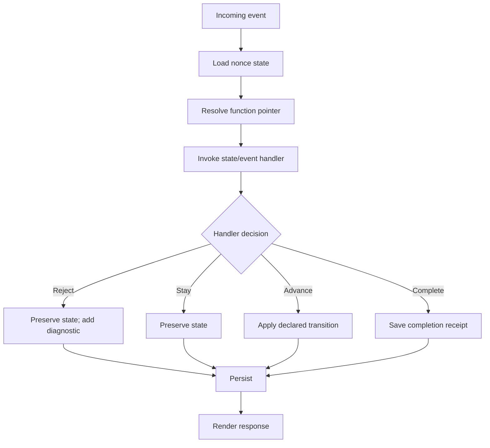
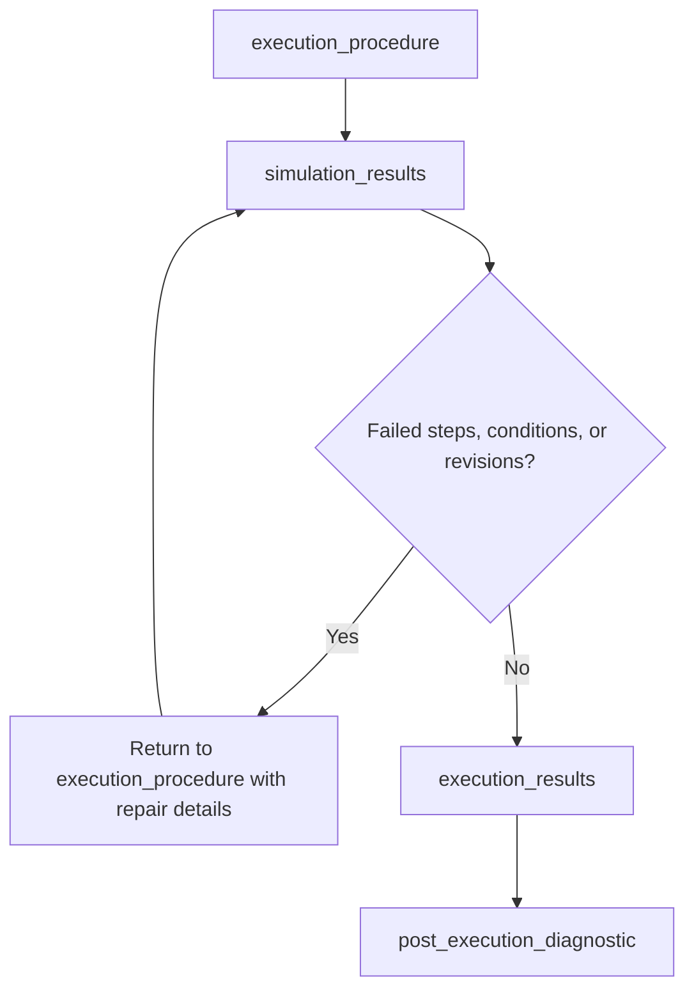

# Conversation

**You**

> Applications is a developmental project to create useful @ for the Terminal MCP.  First, what's our current active AGENTS.md or AGENTS.json if any.

**Assistant**

## Current AGENTS configuration

**The Applications project has no `AGENTS.md` or `AGENTS.json` attached to its project files.** No project-level AGENTS document has been identified as governing this conversation.

A live inspection of the Terminals Codespace found four files\:

| Location | File |
|--------|--------|
| Terminals repository root | `AGENTS.md` |
| `workspaces/2d-state-event-procedure-design/` | `AGENTS.md` |
| `workspaces/2d-state-event-procedure-design/` | `AGENTS.json` |
| `workspaces/codespace-mcp-srs-design/` | `AGENTS.md` |

These files exist in the Terminals development environment. Their existence does not automatically make them active instructions for the Applications ChatGPT project.

## Which instructions apply?

- **Applications project\:** No active AGENTS file identified. ChatGPT project instructions and account-level custom instructions still apply.
- **Terminals repository\:**  is the repository-level execution contract, version `1.0.0`\. It contains legacy Issue \#3 and direct-integration requirements.
- **2D procedure workspace\:**  is expressly designated as the authoritative local behavioral document by its companion `AGENTS.md`\.
- **MCP SRS workspace\:** Its local `AGENTS.md` supplements the repository-level contract.

**Conclusion\:** We currently have no Applications-specific AGENTS file. The Terminals repository has its own instructions, but those should not be confused with an Applications-wide instruction contract.

For development of reusable `@` functions, we can establish an Applications-specific `AGENTS.json` without inheriting the legacy Terminals execution contract wholesale.

---

**You**

> Let's do this, let's add as the project instruction with the exact command to start/restart the Terminal MCP via Terminals ISSUE #3.

**Assistant**


---

**You**

> You can't save it, but you can place it in an accessible location and we can reference it.

---

**You**

> The available option is the restart/start codespace.

**Assistant**


---

**You**

> Are you going to be able to get it done? Youre taking an excessive amount of time to resolve it.

**Assistant**

(Saved and verified)

The Applications project instruction is committed to `BestNameYet/Terminals` on `main`\.

****

Commit: `e303065ad107394aec1f8c9e9557d03f818c5408`

The instruction defines\:

- **Start\:** Issue \#3 executes `gh api --method POST 'user/codespaces/shiny-robot-v64x5jj4v4q2x96/start'`\.
- **Restart\:** Stop the Codespace, confirm it has stopped, then start it.
- **Verification\:** Inspect the Issue \#3 execution results and actual Codespace state.
- **Identity\:** Use a distinct `forWhom` identifier for each invocation.

### Add this to Applications Project Instructions

Reference instruction

Read and follow the Applications project instruction at  when starting or restarting the Terminal MCP Codespace through Terminals Issue \#3.

[Copy]

The file was read back from GitHub and its contents verified. No Codespace restart was performed.

---

**You**

> {
>   "title": "Direct access to the MCP server working directory",
>   "applicability": "Reading or updating files directly in the Terminals Codespace filesystem.",
>   "working_directory": "/workspaces/Terminals",
>   "method": "Execute shell filesystem commands inside the Codespace. Use the user-requested file path and content.",
>   "command_lifetime": "Each invocation starts a fresh shell. Include variable assignments, directory selection, and filesystem operations in the same invocation.",
>   "file_commands": {
>     "list_directory": "ls -la /workspaces/Terminals/references",
>     "read_file": "cat -- /workspaces/Terminals/references/imperatives.json",
>     "write_example": "printf '%s\\n' '[]' > /workspaces/Terminals/references/imperatives.json",
>     "write_example_effect": "Replace imperatives.json with an empty JSON array followed by a newline."
>   },
>   "terminal_mcp": {
>     "tool": "terminal_execute",
>     "execution_location": "The MCP server's Codespace.",
>     "request_example": {
>       "runOn": "$",
>       "whatPrompt": "set -e\nprintf '%s\\n' '[]' > /workspaces/Terminals/references/imperatives.json\ncat -- /workspaces/Terminals/references/imperatives.json",
>       "forWhom": "GPT6_1000000007-direct_write_mcp-Terminals"
>     }
>   },
>   "issue_3": {
>     "submission_location": "https://github.com/BestNameYet/Terminals/issues/3",
>     "submission_format": "Submit the complete request object as the body of a repository-owner-authored issue comment.",
>     "execution_location": "The issue workflow starts on a GitHub Actions runner. Use gh codespace ssh to execute the filesystem commands inside the target Codespace.",
>     "codespace_name": "shiny-robot-v64x5jj4v4q2x96",
>     "request_example": {
>       "runOn": "$",
>       "whatPrompt": "gh codespace ssh -c shiny-robot-v64x5jj4v4q2x96 -- bash -s <<'REMOTE_FILESYSTEM'\nset -e\nprintf '%s\\n' '[]' > /workspaces/Terminals/references/imperatives.json\ncat -- /workspaces/Terminals/references/imperatives.json\nREMOTE_FILESYSTEM",
>       "forWhom": "GPT6_1000000007-direct_write_issue3-Terminals"
>     },
>     "result_access": "Read the command stdout from its workspaces/terminalruns result file and inspect the corresponding Actions execution for stderr and exit status."
>   },
>   "invocation_identity": "Assign a distinct forWhom nonce to each invocation using the documented model_prime-task-project format.",
>   "verification": "Check the command exit status and read the target file from the Codespace to verify its contents.",
>   "example_usage": "The request examples demonstrate writing an empty array. Substitute the actual user-authorized path and content with shell-safe quoting before execution."
> }

**Assistant**

This instruction defines two methods for accessing the Terminals Codespace filesystem\:

1. **Terminal MCP (`terminal_execute`\)** — Executes shell commands directly inside `/workspaces/Terminals`\.
2. **GitHub Issue \#3** — Executes commands on a GitHub Actions runner, using `gh codespace ssh` to reach the Codespace filesystem.

The distinction is important: Issue \#3 does not execute inside the Codespace unless the command explicitly establishes that connection.

The examples involving `imperatives.json` are illustrative, not instructions to overwrite that file.

Do you want this JSON **appended as a separate instruction** to the existing , preserving its current start/restart procedure?

---

**You**

> Actually this is outdated, the file is name imperative.json and its in the surfaces repo....I use it to injuect hot context directly into every tool call.

**Assistant**

Confirmed. The current file is\:

****

I verified that it exists on `main` and contains a JSON array of instructions.

The corrected architecture is\:

- **Repository\:** `BestNameYet/Surfaces`, not `Terminals`\.
- **Filename\:** `imperative.json`, singular.
- **Purpose\:** Supplies hot-context instructions for injection into Terminal MCP tool responses.
- **Mechanism\:** The MCP server incorporates this context into its tool responses, making it available to the agent without requiring a separate file-read operation.

The earlier filesystem instruction is outdated and should not be added to Applications in its existing form.

The Applications project startup instruction can remain separate. **Surfaces provides the dynamic instruction content; Terminals provides the execution interface.**

I've verified the file's existence and contents, but not yet independently verified the server-side injection mechanism. No files were modified.

---

**You**

> No, add an instruction modeled after the deprecated one to give an exact procedure to update imperative.json

**Assistant**

**Completed.** Added the new instruction to the Applications project reference file and verified it on GitHub.


Commit: `fd1d875026b0fc25f8a6a3ab5d44d89f60bbd6f9`

### New instruction

`procedures.update_surfaces_imperative`

The instruction specifies\:

- **Target\:** `BestNameYet/Surfaces/references/imperative.json` on `main`\.
- **Direct Terminal MCP\:** Execute the update using `terminal_execute`, with `runOn: "$"`\.
- **Issue \#3\:** Submit the command as a JSON issue comment, executed through GitHub Actions.
- **Supported updates\:** Append an instruction, replace an existing instruction by title, or explicitly replace the entire array.
- **Verification\:** Validate JSON, use the existing GitHub blob SHA, commit the change, and read back the result for byte-for-byte comparison.

The procedure includes a complete 61-line shell command template.

**Preserved\:** The existing Codespace start/restart instructions.

**Unchanged\:** The actual  file.

The new procedure is saved and ready for subsequent use.

---

**You**

> Using @Procedure in terminals review for revision the @procedure implementation with the intention of creating an event driven fsm using function pointers.

**Assistant**

## Preliminary architecture review

The current `@Procedure` implementation already uses **function references for state dispatch**, but it is not yet a general event-driven finite-state machine.

The existing architecture is\:

- `procedure.mjs` manages the procedure nonce, persistent record, replay, and input submission.
- `iterator.mjs` selects the current state's handler from a JavaScript function registry.
- `projection-bindings.json` defines the successor of each state.
- Individual state modules perform schema validation and generate projections.

The principal architectural limitation is that **state selection and transition behavior are primarily driven by a fixed successor chain and input acceptance**, rather than a transition function selected from the pair `(current state, incoming event)`\.

This distinction matters because your proposed design should allow the same state to respond to different events without requiring a separate control flow in the central iterator.

The references support two compatible approaches: a state/event transition table plus function-pointer registry, and state-specific event handlers with entry/exit functions. Geoffrey Hunter's *Event Driven State Machines* favors state-specific event handlers for more complex conditional logic.  

## Completed review

(\@Procedure completed — 13 states accepted)

Nonce: `c3ef5a5d-0c38-47e1-9fe2-49f5ea4cf010`

The architecture review, required changes, agent actions, change-action mapping, execution plan, simulation, and post-execution diagnostic were processed through the live `@Procedure` implementation.

The review was committed to GitHub and verified by readback.

**** [Open](https://github.com/BestNameYet/Terminals/blob/main/workspaces/2d-state-event-procedure-design/reviews/event-driven-function-pointer-fsm-review.md)

Commit `4e875069922616d49f53e07f1fc0a8658ccbb202`

### Recommended architecture

Use a **state/event dispatch matrix containing function references**, with handlers returning explicit transition decisions.





A minimal JavaScript dispatch registry would look like\:


```js
const handlers = {
  verbatim_request: {
    E_RETURN: validateVerbatimRequest,
    E_REPLAY: replayProjection
  },
  user_intent: {
    E_RETURN: validateUserIntent,
    E_REPLAY: replayProjection
  }
};

const handler =
  handlers[currentState]?.[event.type];

const decision = await handler(context, event);
```


The key difference is that handlers produce decisions; **the central FSM applies transitions and persists state**\.

### Revision priorities

| Priority | Component | Required revision |
|--------|--------|--------|
| 1 | `iterator.mjs` | State/event dispatch and typed transition outcomes |
| 2 | `projection-bindings.json` | Event-handler function mapping |
| 3 | State modules | Uniform handler interface and returned decisions |
| 4 | `state-event-contract.json` | Event and transition contract |
| 5 | `procedure.mjs` | Preserve API; establish nonce-scoped event serialization |
| 6 | `render_state.mjs` | Maintain presentation-only responsibilities |
| 7 | Tests and `AGENTS.json` | Full regression coverage and contract alignment |

The reference material supports keeping the transition table declarative while placing conditional event behavior inside state-specific functions. This avoids the limitations of a simple one-event-to-one-transition table for complex logic.  

### Diagnostic result

The procedure reported `overall_result: fail` for the **proposed implementation requirements**, because the runtime refactor was intentionally not executed. This does not indicate that the architecture review or procedure run failed.

The review document was committed successfully. Existing runtime modules were not modified, and no implementation regression tests were run.

**Recommended next revision\:** Begin with the state/event function registry and transition-decision contract, retaining `E_RETURN` as the existing input event. Additional events can then be introduced without redesigning the central iterator.

---

**You**

> It's not a fail because the goal was to design the change not implement it.

**Assistant**

Correct. **The review was successful. The `fail` classification was incorrect.**

I evaluated the outcome against implementation requirements rather than the actual objective: **designing the revision to `@Procedure` as an event-driven FSM using function pointers.**

The requested work was completed\:

- Reviewed the existing implementation and supplied references.
- Identified architectural deficiencies.
- Designed the proposed state/event dispatch architecture.
- Defined required changes and mapped agent actions.
- Produced an ordered execution procedure.
- Simulated the proposed changes.
- Committed and verified the design document.
- Completed all 13 `@Procedure` states.

**Correct outcome: `PASS` — Design phase complete.**

Implementation and runtime regression testing were outside the requested scope. They are future activities, not failures.

The error originated in how I populated `desired_state`\: I incorrectly defined success as having an implemented FSM rather than a completed FSM design. That misclassification propagated into `post_execution_diagnostic`\.

The persisted procedure record still contains the original `fail` result; this correction does not retroactively modify it.

This is also an important distinction for the procedure itself: **completion criteria must be derived from the user's requested deliverable, not from subsequent work described by that deliverable.**

---

**You**

> This next phase is research based, device a best practice to gather addition source of information from blogs, academia, development forums, etc. Compile the "open source" design that available, especially written in node or python, attempt to discover if the previous design could benefit from this exposure.  Set volume and breadth of research goals, set diversity of research goals, etc.

**Assistant**


---

**You**

> Use the @procedure method

**Assistant**


---

**You**

> if terminal is down restart it

**Assistant**

**Terminal MCP is operational again.**

- Codespace startup executed successfully through \.
- GitHub Actions workflow completed successfully.
- `terminal_open` responded successfully.
- `@Procedure` successfully initialized a new research procedure.

**New procedure nonce\:**
`f008d9a9-6cb0-4dd1-9b63-05cf92e7e5f5`

**Current state\:** `verbatim_request` \(State 0).

The Codespace is available, and the research procedure has been initialized.

---

**You**

> Proceed

**Assistant**

## Research phase: methodology and scope

The new `@Procedure` run is active under nonce `f008d9a9-6cb0-4dd1-9b63-05cf92e7e5f5`\.

The research will use a **systematic mapping study**, rather than an informal list of FSM libraries. This is appropriate because the objective is to map available designs, compare architectural approaches, and identify improvements—not to prove that a single framework is universally superior.

The methodology is based on Kitchenham and Charters' systematic review guidelines, Petersen and colleagues' mapping-study guidance, and Wohlin's backward/forward citation-snowballing method. 

### Research acceptance targets

| Measure | Target |
|--------|--------|
| Candidate resources discovered | At least 40 |
| Distinct relevant resources retained | At least 30 |
| JavaScript / TypeScript / Node.js open-source projects | At least 8 |
| Python open-source projects | At least 8 |
| Academic papers and formal standards | At least 4 |
| Independent engineering articles | At least 4 |
| Developer forum discussions | At least 4 |
| Architectural dimensions evaluated | At least 9 |

Each retained source will be classified by origin, language, design pattern, direct evidence, relevance, and limitations. Missing categories will be reported as coverage gaps rather than filled with unverified examples.

The comparison will distinguish **ideas worth borrowing, libraries worth testing, and architectural features that would add unnecessary complexity** to the existing `@Procedure` implementation.

---

**You**

> Don't forget, the goal is to make a concrete design of a 2d FSM function pointer machine...not speculative additions, but a revised substrate

**Assistant**

## Research completed — 2D FSM substrate design

(\@Procedure complete — PASS)

The research phase was completed using the live Terminals `@Procedure`, with all **13 states accepted** and a persisted `overall_result: "pass"`\.

Procedure nonce: `f008d9a9-6cb0-4dd1-9b63-05cf92e7e5f5`

All six research artifacts were committed to `BestNameYet/Terminals` on `main` and verified by readback.

## 1\. Research coverage

# 41

Candidates screened

# 35

Sources retained

# 28

Defined FSM cells

| Source category | Target | Retained |
|--------|--------|--------|
| JavaScript / TypeScript projects | 8 | 11 |
| Python projects | 8 | 10 |
| Formal / academic sources | 4 | 5 |
| Engineering articles | 4 | 5 |
| Developer discussions | 4 | 4 |
| **Total retained** | **28 minimum by category** | **35** |

Six candidates were excluded. No duplicate URLs were found. The corpus distinguishes repository-level discovery from deeper documentation or implementation evidence; it is not a claim that all 35 sources received a full code audit.

## 2\. Concrete architectural conclusion

The revised substrate is a two-dimensional matrix whose cells contain callable function references\:

\[
M[\text{state}][\text{event}] \rightarrow \text{handler function}
\]

Representative section of the proposed matrix

| Current state | E\_RETURN | E\_REPLAY |
|--------|--------|--------|
| verbatim\_request | validateVerbatim | replayStored |
| user\_intent | validateIntent | replayStored |
| clarifying\_questions | validateQuestions | replayStored |
| … | … | … |
| post\_execution\_diagnostic | validateDiagnostic | replayStored |
| COMPLETE | replayCompletion | replayCompletion |

Full specification: 14 state rows × 2 event columns = 28 function-reference cells.

The research supports three important refinements\:

- **Direct function-pointer dispatch\:** The state/event pair resolves a callable without a central state-specific conditional tree. This pattern is supported by function-pointer transition-table literature and the compact handler model of machina.js. 
- **Explicit handler results\:** A handler produces `ACCEPT`, `REJECT`, `REPLAY`, or `REPLAY_COMPLETE`; the central controller applies the declared transition and persists the record.
- **Run-to-completion\:** One event's transition must finish before another mutable event for the same nonce is processed. This aligns with SCXML processing semantics and Python FSM implementations. 

The revised substrate deliberately excludes new event types, hierarchy, actors, and orthogonal state regions. Those features are not necessary to achieve the requested 2D design.

## 3\. Research artifacts

****

All 28 cells, function-reference paths, accepted successors, event definitions, and invariants.

---

****

JavaScript reference code, transition decision protocol, persistence sequence, migration mapping, and test requirements.

---

****

Annotated source registry covering Node.js, Python, academic work, engineering articles, and forums.

---

****

Eleven architecture comparisons with explicit adoption, preservation, and exclusion decisions.

---

****

Search strategy, quotas, screening, deduplication, evidence depth, and stopping criteria.

---

****

Actual source counts, GitHub file hashes, readback verification, and scope limitations.

## 4\. Design status

**Research and concrete substrate specification: PASS.**

The matrix is derived from the existing `projection-bindings.json` and preserves all 13 state keywords and their existing successor relationships. It also defines the completed-state behavior explicitly.

The distinction for the next phase is precise: the **function-reference matrix is fully specified but not yet wired into the runtime**\. Its stored references are symbolic declarations that must be resolved to actual JavaScript functions during implementation.

No existing production `@Procedure` modules were changed. The next engineering phase is therefore to replace the current one-dimensional dispatch with the defined two-dimensional substrate, while retaining the existing state validation and nonce-persistence contracts.

---

**You**

> Using Procedure -r show me a walk through by summarizing the response and inputs to the ui

**Assistant**

## `Procedure -r` walkthrough

I started a new run of the **revised Procedure** through the live Terminals MCP.

**Session initialized** (Accepted)

Nonce

`a2fbc77a-78d8-4698-acaa-d086a395edff`

**Input command\:** `Procedure -r`

**Response summary\:** The server created a persistent procedure record and returned the first projection, `verbatim_request`, with its instructions and JSON return schema.

**Requested input\:** A JSON object containing the original task description under `verbatim_request`\.

The documented interface uses `Procedure -r <nonce> {JSON input}` to advance and `Procedure -r <nonce>` to replay the saved projection. I’ll use the two-dimensional FSM design as the walkthrough task and summarize the returned projection after each accepted input.

### Walkthrough: inputs submitted and responses received

The revised procedure begins with observation before clarification and planning.

| Step | Input submitted | Response returned |
|--------|--------|--------|
| 1\. `verbatim_request` | Exact user request, unchanged | `user_intent` projection |
| 2\. `user_intent` | Objective, five subgoals, five constraints, and requested outcome | `current_state` projection |

The `current_state` response instructs the agent to inspect the relevant implementation **without changing it**, then provide observations with evidence and a list of unknowns.

This is a substantive difference from the original Procedure sequence, which asked for clarifying questions earlier.

| Step | Input submitted | Response returned |
|--------|--------|--------|
| 3\. Replay demonstration | Nonce only; no JSON input | Same saved `current_state` projection; no advancement |
| 4\. `current_state` | Four source-backed observations; no unknowns | `clarifying_questions` |
| 5\. `clarifying_questions` | Empty array `[]` | `desired_state`; `question_answers` skipped |
| 6\. `desired_state` | Four measurable acceptance conditions | `required_changes` |
| 7\. `required_changes` | Two changes, both targeting this UI walkthrough | `agent_actions` |
| 8\. `agent_actions` | Two actions linked to their corresponding changes | `execution_procedure` |

**Question-skipping behavior verified\:** Because no answer was needed to change the task's scope, approach, or verification, submitting `{"clarifying_questions":[]}` moved directly to `desired_state`\. The revised controller automatically recorded `question_answers: []`\.

| Step | Input submitted | Response returned |
|--------|--------|--------|
| 9\. `execution_procedure` | Two ordered steps: `S1` constructs the walkthrough, `S2` explains revised behavior; `S2.depends_on = ["S1"]` | `simulation_results` |
| 10\. `simulation_results` | Predicted results for both steps, four acceptance checks, all marked passing, no revisions requested | `execution_results` |

### What the preflight does

The simulation is a **pre-execution gate**\. It checks the proposed plan against the desired acceptance conditions; the `passed` values are predictions, not evidence of actual execution.





In this live run, all four simulated checks passed and `revisions` was empty, so the server advanced to `execution_results`\. The repair branch is documented in the implementation but was **not exercised** in this run.

| Step | Input submitted | Response returned |
|--------|--------|--------|
| 11\. `execution_results` | Two executed documentation actions, both marked `success`, with observable evidence | `post_execution_diagnostic` |
| 12\. `post_execution_diagnostic` | Four original checklist conditions, now supplemented with actual results and evidence; `overall_result: "pass"` | Persisted completion receipt |
| 13\. Completion replay | `Procedure -r <nonce>` without new input | Same saved completion receipt |

## Final server response

**Revised Procedure** (PASS)

Actual completion message

> Revised procedure complete. See post\_execution\_diagnostic for verification results.

---

# 12

Persisted keyword values

# 4/4

Diagnostic conditions passed

The 12 persisted values include `question_answers: []`, automatically populated when clarification was skipped.

## What this walkthrough establishes

The live revised procedure successfully demonstrated initialization, nonce replay, observation-first processing, optional clarification, dependency-aware planning, simulation preflight, execution reporting, diagnostic validation, and persistent completion replay.

A replay after completion independently confirmed `completed: true` and `overall_result: "pass"`\.

**Result\:** The walkthrough is complete. No Terminals implementation files were modified.

For reference, the current interface is documented in the \.

---

**You**

> Why do the questions have to change scope

**Assistant**

They don't. **Changing scope should not be a requirement for asking a clarifying question.**

The current `Procedure -r` specification says to omit questions whose answers would not affect **scope, approach, or verification**\. Scope is only one of three criteria, not a mandatory condition. 

However, that rule is still unnecessarily restrictive.

A question can be valuable without changing any of those three things. It might\:

- Resolve missing information needed to complete a step.
- Establish a technical requirement or constraint.
- Clarify dependencies or execution order.
- Identify an ambiguity in the current observations.
- Obtain information needed for an accurate design.

### Recommended revision

Replace the existing question-selection rule with\:

> Generate clarifying questions when their answers would provide information materially relevant to understanding, designing, executing, or verifying the user's requested outcome. Do not require the answers to change the established scope or approach. Avoid redundant questions and questions already answered by available evidence.

The distinction is between **obtaining necessary information** and **changing an existing decision**\.

The purpose of `clarifying_questions` should be to resolve relevant uncertainty, not to require justification through a potential change in scope.

---

**You**

> use procedure -r to verify that the question criteria have changed

**Assistant**

## Verification: question criteria

**The repository specification has not changed.** The current `main` version of `workspaces/revised-procedure/state-instructions-and-return-schemas.json` still contains\:

> Omit questions whose answers would not affect scope, approach, or verification.

The schema also still requires a `decision` field for each clarifying question.

The previously recommended broader criterion—questions that provide materially relevant information without necessarily changing scope or approach—is **not present** in the inspected source.

I’ll check the live `Procedure -r` projection next to determine whether the running server uses the same criterion.

### Live `Procedure -r`\: changed

The running server returned the **new criterion**\:

> Generate clarifying questions when their answers would provide information materially relevant to understanding, designing, executing, or verifying the user's requested outcome. Do not require the answers to change the established scope or approach. Avoid redundant questions and questions already answered by available evidence.

The live projection also changed the expected question fields\:

| Field | Earlier specification | Live projection |
|--------|--------|--------|
| `id` | Required | Required |
| `question` | Required | Required |
| `decision` | Required | Not required |

**Conclusion so far\:** The live `Procedure -r` has adopted the revised criterion, but GitHub `main` still contains the previous version. I’ll check the Codespace working copy to establish where the difference resides.

### Codespace verification

The read-only filesystem inspection established why the live server and GitHub `main` differ.

| Check | Result |
|--------|--------|
| Live question-selection criterion | Updated |
| Live question schema | Updated; `decision` removed |
| Codespace working file | Updated |
| GitHub `main` | Still contains old criterion |
| Git working-tree status | Modified, uncommitted |
| Runtime test | Reached `clarifying_questions` and returned updated instructions |

The changed files are\:

- `workspaces/revised-procedure/state-instructions-and-return-schemas.json`
- `workspaces/revised-procedure/README.md`

**Verification result: PASS for the live implementation.** The revised clarification criteria are active and the live schema matches them.

**Outstanding\:** Commit the existing Codespace changes to GitHub `main` to make the revision part of the repository's recorded version. I made no file changes during this verification.

---

**You**

> sync them

**Assistant**

The Codespace has newer versions of both files\:

- `workspaces/revised-procedure/state-instructions-and-return-schemas.json`
- `workspaces/revised-procedure/README.md`

GitHub `main` is one commit ahead of the Codespace, but that commit does not change either target file. I can sync both without overwriting the newer remote commit.

Other uncommitted Codespace changes will be left untouched.

(Sync successful)

Both files were committed and pushed to GitHub `main`\.

**Commit\:** 

The sync includes the revised clarifying-question criteria, removal of the required `decision` field, and the current README updates.

**Verification\:** The remote commit matches the Codespace contents of both files byte-for-byte.

All other uncommitted Codespace changes remain untouched. The Codespace's local Git HEAD was not moved; the authoritative GitHub `main` is updated.

---

If you want, I can:

- Outline next steps to implement function-pointer matrix in runtime
- Draft a clear summary explaining the revised Procedure replay behavior
- Propose updates to the clarification question criteria and workflow
